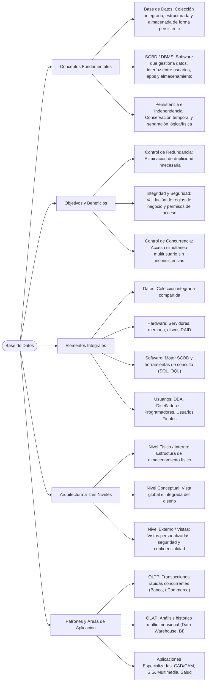

<!-- Start of picture text -->
=a as TECNOLOGICO NACIONAL DE MEXICO <!-- End of picture text -->

#### **Instituto Tecnológico Nacional de Monclova** 

**LICENCIATURA EN INFORMÁTICA** 

# **SISTEMAS DE BASES DE DATOS: FUNDAMENTOS, OBJETIVOS Y MODELOS** 

_Informe Académico Formal, Mapa Conceptual Analítico y Cuadro Comparativo de Arquitecturas de Datos_ 

**Asignatura:** Fundamentos de Bases de Datos 

**Docente:** Rubén Miguel Riojas Rodríguez **Alumno:** Eduardo Salazar Martínez **Formato de Documento:** Normas APA (7.ª Edición) 

Sistemas de Bases de Datos | Fundamentos, Objetivos y Modelos 

## **Índice de Contenidos** 

## **Contenido** 

|Índice de Contenidos ..........................................................................................................................2|
|---|
|1. Introducción y Conceptos Fundamentales de las Bases de Datos........................................................3|
|1.1 Arquitectura a Tres Niveles de Abstracción .................................................................................3|
|1.2 Elementos Constitutivos de un SGBD ..........................................................................................4|
|2. Objetivos, Ventajas, Usos y Áreas de Aplicación ................................................................................4|
|2.1 Objetivos Principales de las Bases de Datos .................................................................................4|
|2.2 Usos y Patrones de Procesamiento .............................................................................................5|
|2.3 Áreas de Aplicación Contemporáneas .........................................................................................5|
|3. Modelos de Bases de Datos y Tabla Comparativa ..............................................................................6|
|3.1 Descripción de los Modelos Principales .......................................................................................6|
|3.2 Tabla Comparativa Sintética de Modelos de Bases de Datos.........................................................7|
|4. Referencias Bibliográficas ................................................................................................................8|

Página 2 de 8 

Sistemas de Bases de Datos | Fundamentos, Objetivos y Modelos 

## **1. Introducción y Conceptos Fundamentales de las Bases de Datos** 

En el entorno organizacional e informático moderno, las **bases de datos** constituyen la columna vertebral del almacenamiento, procesamiento y consulta de la información. Una base de datos se define formalmente como una colección organizada, estructurada e integrada de datos relacionados que se almacenan de manera persistente en soportes secundarios (Date, 2001; Silberschatz et al., 2006). La propiedad de **persistencia** es un atributo crítico que garantiza que la información permanezca disponible a lo largo del tiempo, más allá de la ejecución de programas de aplicación específicos (Kanaguisco, 2017a). 

Para gestionar eficazmente estas colecciones de datos se requiere un soporte de software especializado denominado **Sistema Administrador de Bases de Datos (SGBD)** o DBMS (by its acronym in English, _Database Management System_ ). El SGBD actúa como una interfaz uniforme de software entre la base de datos física, los usuarios finales y las aplicaciones, facilitando operaciones confiables de almacenamiento, recuperación, actualización, control de concurrencia y seguridad (Johnson, 1997). 

#### **1.1 Arquitectura a Tres Niveles de Abstracción** 

Uno de los pilares conceptuales del diseño de bases de datos es la capacidad de ocultar la complejidad del almacenamiento físico a los usuarios finales mediante **niveles de abstracción** (Date, 2001; Grupo de Bases de Datos Avanzadas - UC3M, s. f.). Esta arquitectura se divide formalmente en tres esquemas: 

- **Nivel Físico o Interno:** Describe la estructura de almacenamiento físico de los datos en el disco u otros soportes secundarios. Define la asignación de espacio, punteros, índices, técnicas de compresión y mecanismos de emplazamiento de registros lógicos en bloques físicos. 

- **Nivel Conceptual o Lógico Global:** Representa la estructura lógica completa de la base de datos para toda la organización (esquema conceptual). Oculta los detalles físicos y describe qué datos están almacenados, sus interrelaciones, tipos de datos y restricciones de integridad empresarial. 

- **Nivel Externo o de Vistas:** Constituye la percepción de los datos orientada a usuarios o aplicaciones específicas (esquemas externos). Permite personalizar la interfaz de datos y restringir el acceso a partes específicas de la base de datos por razones de confidencialidad y usabilidad. 

Página 3 de 8 

Sistemas de Bases de Datos | Fundamentos, Objetivos y Modelos 

#### **1.2 Elementos Constitutivos de un SGBD** 

De acuerdo con la sistematización realizada por Date (2001), un sistema de base de datos se integra 

operacionalmente por cuatro componentes esenciales: 

- **Datos:** La información factual integrada y compartida que refleja los procesos reales de la organización. 

- **Hardware:** Los recursos físicos de procesamiento, memoria y almacenamiento secundario (servidores corporativos, discos en arreglo RAID). 

- **Software (SGBD):** El conjunto de programas de gestión y motores de base de datos (por ejemplo, Oracle, PostgreSQL, MySQL, SQL Server) encargados de procesar lenguajes de definición (DDL) y manipulación de datos (DML). 

- **Usuarios:** Los actores que interactúan con el sistema, incluyendo administradores de bases de datos (DBA), diseñadores de esquemas, programadores de aplicaciones y usuarios finales. 

## **2. Objetivos, Ventajas, Usos y Áreas de Aplicación** 

#### **2.1 Objetivos Principales de las Bases de Datos** 

El desarrollo e implementación de los SGBD surgió como respuesta directa a las severas limitaciones de los sistemas de archivos tradicionales orientados a procesos (UC3M, s. f.). Los objetivos primordiales de un SGBD abarcan: 

- **Control de Redundancia e Inconsistencia:** Eliminar la duplicación innecesaria de datos entre departamentos para reducir costos de almacenamiento y prevenir divergencias lógicas entre copias de la misma información (Silberschatz et al., 2006). 

- **Independencia de los Datos:** Garantizar la independencia mutua entre las estructuras de datos y los programas de aplicación. La independencia física permite cambiar el almacenamiento sin modificar programas, mientras que la independencia lógica permite alterar el esquema conceptual sin romper las vistas externas. 

- **Gestión de Concurrencia y Control de Anomalías:** Prevenir inconsistencias cuando múltiples usuarios realizan transacciones simultáneas de lectura y escritura mediante mecanismos de bloqueo y propiedades ACID (Atomicidad, Consistencia, Aislamiento, Durabilidad). 

- **Seguridad e Integridad:** Implementar reglas de negocio estrictas (restricciones de clave, integridad referencial) y controles de acceso basados en roles para proteger la confidencialidad frente a usuarios no autorizados. 

Página 4 de 8 

Sistemas de Bases de Datos | Fundamentos, Objetivos y Modelos 

#### **2.2 Usos y Patrones de Procesamiento** 

Las bases de datos responden a dos modalidades operativas fundamentales en la arquitectura empresarial (Kanaguisco, 2017b; Lucid Software, 2026): 

**Patrones Principales de Procesamiento de Información:** 

**1. Procesamiento de Transacciones en Línea (OLTP):** Orientado a operaciones cotidianas rápidas (consultas, inserciones, actualizaciones individuales) con alta concurrencia y consultas simples sobre datos altamente estructurados y normalizados. 

**2. Procesamiento Analítico en Línea (OLAP):** Optimizado para el análisis de grandes volúmenes de datos históricos, agregaciones complejas y minería de datos en Data Warehouses y cubos multidimensionales para la toma de decisiones estratégicas. 

#### **2.3 Áreas de Aplicación Contemporáneas** 

Las bases de datos se emplean transversalmente en todos los sectores productivos e institucionales modernos: 

- **Banca y Servicios Financieros:** Administración de cuentas corrientes, control de saldo en tiempo real, seguimiento de tarjetas de crédito y detección de fraudes mediante consultas concurrentes de alta velocidad. 

- **Comercio Electrónico (eCommerce) y Retail:** Gestión de catálogos de productos, control de inventario dinámico, procesamiento de carritos de compra y trazabilidad de pedidos con relaciones complejas entre compradores, artículos y vendedores (Hosting Plus México, 2021). 

- **Sistemas CAD/CAM y Multimedia:** Diseño asistido por computadora, aplicaciones geográficas (SIG) y repositorios multimedia que manejan objetos complejos y archivos no estructurados mediante modelos avanzados OODBMS y NoSQL (Kanaguisco, 2017b). 

- **Salud y Educación:** Expedientes clínicos electrónicos interoperables, control de admisiones hospitalarias y plataformas de gestión académica integradas. 

Página 5 de 8 

Sistemas de Bases de Datos | Fundamentos, Objetivos y Modelos 

## **3. Modelos de Bases de Datos y Tabla Comparativa** 

Un **modelo de base de datos** determina la estructura lógica y la forma en que los datos se conceptualizan, organizan, almacenan y manipulan dentro de un SGBD (Lucid Software, 2026). A lo largo de la evolución tecnológica de la informática, se han desarrollado diversos paradigmas de modelado para responder a necesidades cambiantes de complejidad y rendimiento: 

#### **3.1 Descripción de los Modelos Principales** 

- **Modelo Jerárquico:** Surgido en la década de 1960 (ej. IMS de IBM), organiza los datos en una estructura de árbol invertido con una raíz única. Cada nodo hijo posee un único nodo padre (relación estricta 1:N). La navegación física depende de punteros rígidamente estructurados (Lucid Software, 2026). 

- **Modelo de Red (Plex):** Estandarizado por CODASYL en los años 70, extiende el modelo jerárquico permitiendo que un nodo hijo tenga múltiples nodos padres (relaciones N:M). Los registros se agrupan en conjuntos de propietarios e integrantes mediante grafos dirigidos de punteros (Hosting Plus México, 2021). 

- **Modelo Relacional:** Introducido por E. F. Codd en 1970, constituye el estándar industrial dominante. Modela la información mediante tablas matemáticamente rigurosas (relaciones) compuestas por filas (tuplas) y columnas (atributos). La vinculación entre tablas se establece conceptualmente mediante llaves primarias y foráneas, manipuladas mediante SQL (Date, 2001; Silberschatz et al., 2006). 

- **Modelo Orientado a Objetos (OODBMS):** Desarrollado para superar las limitaciones del modelo relacional en aplicaciones complejas (CAD/CAM, SIG, multimedia). Almacena los datos en forma de objetos que integran atributos de estado y métodos de comportamiento, soportando herencia, encapsulamiento, identidad única de objeto (OID) y polimorfismo (Kanaguisco, 2017b; Atkinson et al., 1992). 

- **Modelo Relacional de Objetos (ORDBMS):** Modelo híbrido que añade capacidades orientadas a objetos (tipos de datos abstractos, clases, herencia) sobre una arquitectura relacional tradicional basada en tablas y lenguajes extendidos como SQL3 (Lucid Software, 2026). 

- **Modelos NoSQL (Documentos, Grafos, Clave-Valor):** Arquitecturas posrelacionales optimizadas para Big Data, baja latencia y esquemas dinámicos o semiestructurados. Destacan las bases de datos orientadas a documentos (JSON/BSON), grafos (nodos y aristas) y almacenes clave-valor (Lucid Software, 2026). 

Página 6 de 8 

Sistemas de Bases de Datos | Fundamentos, Objetivos y Modelos 

#### **3.2 Tabla Comparativa Sintética de Modelos de Bases de Datos** 

En la siguiente tabla se presenta un análisis comparativo de las características estructurales y funcionales de cada modelo: 

|**Modelo de** **BD**|**Definición y** **Origen**|**Representación de** **Datos**|**Estructura de** **Relaciones**|**Lenguaje /** **Estándar**|**Ventajas y Caso de Uso** **Ideal**|
|---|---|---|---|---|---|
|**Jerárquico**|Estructura en árbol con nodo raíz único (Años 60, ej. IBM IMS).|Árbol invertido de registros padre e hijo.|1:N (Un hijo solo puede tener un padre).|DL/1 y lenguajes del sistema operativo.|Alta velocidad de lectura en datos estrictamente jerárquicos (archivos de nómina).|
|**Red (Plex)**|Grafo lógico de registros interconectados (CODASYL, Años 70).|Red o grafo de nodos (registros) y enlaces (punteros).|N:M (Un hijo puede tener múltiples padres).|DBTG / DML de navegación mediante punteros.|Mayor flexibilidad que el jerárquico. Ideal para inventarios y pedidos de eCommerce.|
|**Relacional**|Modelo matemático basado en teoría de conjuntos (Codd, 1970).|Tablas bidimensionales (Relaciones) con tuplas y atributos.|1:1, 1:N, N:M vinculados por Llaves Primarias/Forán eas.|SQL (Structured Query Language). Estándar ANSI/ISO.|Normalización, consistencia ACID, independencia lógica/física. Estándar corporativo (OLTP).|
|**Orientado a** **Objetos**|Integración del paradigma POO en almacenamiento (Manifiesto 1992).|Objetos complejos con estado (atributos) y métodos (conducta).|Herencia, agregación y referencias OID implícitas.|OQL (Object Query Language), Java, C++.|Elimina el desajuste de impedancia. Ideal para aplicaciones CAD/CAM, SIG y multimedia.|
|**Relacional de** **Objetos**|Extensión híbrida del modelo relacional tradicional.|Tablas con columnas de tipos abstractos (UDT) y objetos.|Relaciones relacionales más jerarquías de clases.|SQL3 / SQL:1999 y extensiones propietarias.|Combina la potencia analítica de SQL con tipos de datos complejos en un solo motor.|
|**NoSQL**|Modelos|Documentos|Flexible /|APIs de consulta|Escalabilidad horizontal|
|**(Documentos /** **Grafos)**|posrelacionales para almacenamiento horizontal distribuido.|JSON/BSON, pares Clave-Valor o Grafos.|Dinámica sin esquema fijo predefinido.|JSON, Gremlin, Cypher, NoSQL DML.|masiva y alta disponibilidad para Big Data y analítica en la web.|

Página 7 de 8 

Sistemas de Bases de Datos | Fundamentos, Objetivos y Modelos 

## **4. Referencias Bibliográficas** 

Las siguientes referencias bibliográficas han sido estructuradas siguiendo rigurosamente el formato APA (7.ª edición) a partir de los materiales y fuentes académicas consultadas: 

- **Atkinson, M., Bancilhon, F., DeWitt, D., Dittrich, K., Maier, D., & Zdonik, S.** (1992). The Object-Oriented Database System Manifesto. En _Proceedings of the First International Conference on Deductive and Object-Oriented Databases_ (pp. 223–240). Morgan Kaufmann. 

- **Date, C. J.** (2001). _Introducción a los sistemas de bases de datos_ (7.ª ed.). Pearson Educación. 

- **Elmasri, R., & Navathe, S. B.** (2007). _Fundamentos de sistemas de bases de datos_ (5.ª ed.). Pearson Educación / Addison Wesley. 

- **Grupo de Bases de Datos Avanzadas - Universidad Carlos III de Madrid.** (s. f.). _Concepto y Objetivos de las Bases de Datos_ [Material docente de curso OpenCourseWare]. UC3M. https://ocw.uc3m.es/pluginfile.php/732/mod_page/content/22/conceptos_objetivos_bases.pdf 

- **Hosting Plus México.** (2021, 5 de julio). _Modelo de red de una base de datos: ¿cuáles son sus características?_ Blog Hosting Plus. https://www.hostingplus.mx/blog/modelo-de-red-de-unabase-de-datos-cuales-son-sus-caracteristicas/ 

- **Johnson, J. L.** (1997). _Bases de datos: Modelos, lenguajes, diseño_ . Oxford University Press. 

- **Kanaguisco Hernández, E. D.** (2017a). _Sistema Administrador de Base de Datos_ [Recurso Educativo Abierto UAPA]. Coordinación de Universidad Abierta y Educación a Distancia (CUAED), UNAM. 

- **Kanaguisco Hernández, E. D.** (2017b). _Modelo Orientado a Objetos_ [Recurso Educativo Abierto UAPA]. Coordinación de Universidad Abierta y Educación a Distancia (CUAED), UNAM. 

- **Lucid Software Inc.** (2026, 12 de junio). _¿Qué es un modelo de base de datos?_ Lucidchart Recursos de Diagramación. https://lucid.co/es/diagrama/base-de-datos/modelos-de-bases-de-datos 

- **Silberschatz, A., Korth, H. F., & Sudarshan, S.** (2006). _Fundamentos de bases de datos_ (5.ª ed.). McGrawHill Interamericana. 

Página 8 de 8 

