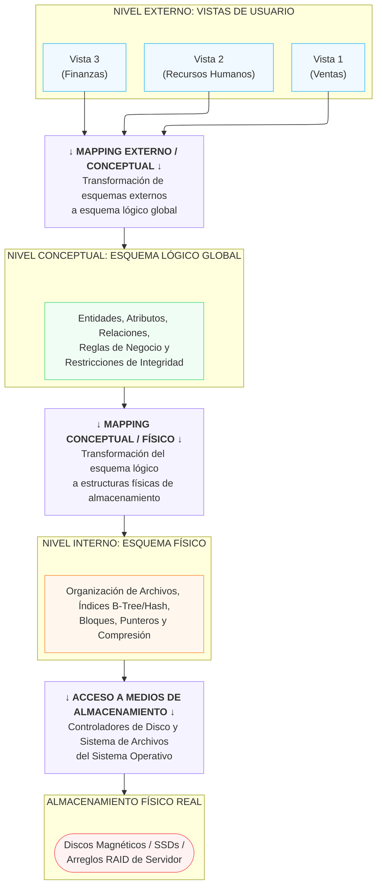
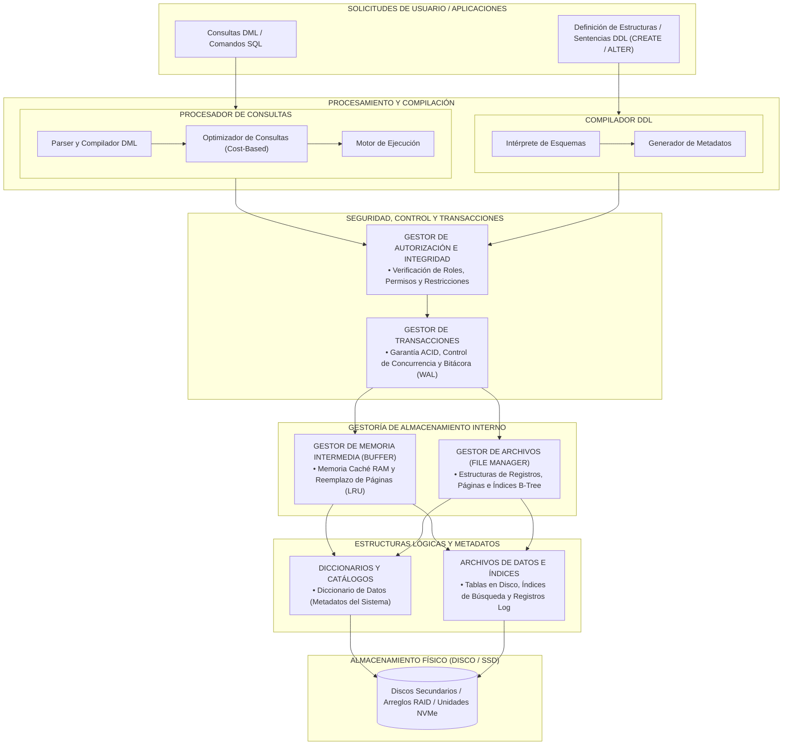
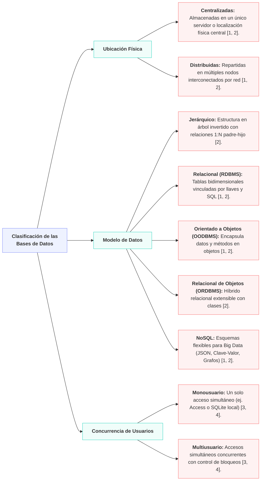

<!-- Start of picture text -->
= i=o TECNOLOGICO NACIONAL DE MEXICO <!-- End of picture text -->

**Instituto Tecnológico Nacional de Monclova LICENCIATURA EN INFORMÁTICA** 

## **CLASIFICACIÓN Y ARQUITECTURAS DE SISTEMAS DE BASES DE DATOS** 

**Asignatura:** Fundamentos de Bases de Datos 

**Docente:** Rubén Miguel Riojas Rodríguez 

**Alumno:** Eduardo Salazar Martínez **Formato de Documento:** Normas APA (7.ª Edición) 

Sistemas de Bases de Datos | Arquitecturas ANSI/SPARC y SGBD 

### **Índice de Contenidos** 

#### **Contenido** 

|Índice de Contenidos .............................................................................................................................................. 2|
|---|
|1. Introducción y Fundamentos de las Bases de Datos........................................................................................ 3|
|1.1 Conceptos Fundamentales ........................................................................................................................... 3|
|1.2 Los Cuatro Componentes Integrantes (Date, 2001) .................................................................................. 4|
|2. Clasificación de las Bases de Datos ................................................................................................................... 5|
|2.1 Tabla Sinóptica de Clasificación de Bases de Datos ................................................................................... 5|
|3. Arquitectura a Tres Niveles de una Base de Datos (ANSI/SPARC) ................................................................... 6|
|3.1 Descripción Explicativa de los Tres Niveles de Abstracción ...................................................................... 6|
|3.2 Diagrama Estructurado de la Arquitectura ANSI/SPARC ........................................................................... 7|
|3.3 Transformaciones (Mapping) e Independencia de Datos ......................................................................... 8|
|4. Arquitectura Funcional Interna del SGBD (DBMS) ........................................................................................... 9|
|4.1 Subsistemas Principales del Motor SGBD ................................................................................................... 9|
|4.2 Diagrama Funcional Interno del Motor SGBD .......................................................................................... 10|
|5. Referencias Bibliográficas ................................................................................................................................. 11|

Página 2 

Sistemas de Bases de Datos | Arquitecturas ANSI/SPARC y SGBD 

### **1. Introducción y Fundamentos de las Bases de Datos** 

Un Sistema de Base de Datos constituye el pilar fundamental del almacenamiento y procesamiento de la información en las organizaciones modernas. De acuerdo con Date (2001) y Silberschatz et al. (2006), una Base de Datos (BD) se define como una colección integrada y estructurada de datos almacenados de forma persistente, diseñados para satisfacer las necesidades de información compartidas por múltiples usuarios y aplicaciones. 

#### **1.1 Conceptos Fundamentales** 

Para comprender la arquitectura global de los sistemas de datos, es esencial diferenciar tres conceptos transversales: 

- **Base de Datos (BD):** Colección de datos interrelacionados almacenados en medios no volátiles, 

- organizados bajo un esquema determinado que representa entidades y relaciones del mundo real. 

**• Sistema Gestor de Bases de Datos (SGBD / DBMS):** Conjunto de programas de software especializados que sirve de interfaz entre la base de datos física, las aplicaciones y los usuarios finales. Facilita la definición, creación, mantenimiento y acceso controlado a los datos. 

- **Persistencia:** Propiedad que garantiza la conservación de la información a lo largo del tiempo, 

- sobreviviendo a la finalización de los procesos que la generaron. 

- **Independencia de Datos:** Principio de diseño que desacopla la representación lógica de la información 

- del modo específico en que se almacena físicamente en los dispositivos de almacenamiento. 

Página 3 

Sistemas de Bases de Datos | Arquitecturas ANSI/SPARC y SGBD 

#### **1.2 Los Cuatro Componentes Integrantes** 

C. J. Date establece que un sistema completo de base de datos se integra por cuatro elementos indispensables: 

|**Componente**|**Descripción y Rol en el Sistema**|
|---|---|
|**Datos**|La información almacenada en el sistema, caracterizada por ser integrada (combina varios archivos eliminando redundancias) y compartida (accesible por múltiples usuarios y aplicaciones).|
|**Hardware**|La infraestructura física necesaria para soportar el almacenamiento y procesamiento: servidores, memoria RAM, controladores de disco, arreglos RAID y redes de comunicación.|
|**Software**|Capa de programas integrada por el propio motor del SGBD, el sistema operativo subyacente, el software de red y las herramientas de aplicación o lenguajes de consulta (ej. SQL).|
|**Usuarios**|Actores del sistema divididos en cuatro categorías: Administrador de la Base de Datos (DBA), Diseñadores de la BD, Programadores de Aplicaciones y Usuarios Finales (ocasionales o expertos).|

Página 4 

Sistemas de Bases de Datos | Arquitecturas ANSI/SPARC y SGBD 

### **2. Clasificación de las Bases de Datos** 

Las bases de datos pueden clasificarse bajo múltiples criterios según la necesidad del negocio, la infraestructura tecnológica y la naturaleza de la información tratada. A continuación se presenta el cuadro sinóptico de clasificación detallado: 

#### **2.1 Tabla Sinóptica de Clasificación de Bases de Datos** 

|**Criterio**|**Categoría**|**Características y Casos de Uso**|
|---|---|---|
|**Variabilidad de** **Datos**|**Estáticas (OLAP)** **Dinámicas (OLTP)**|Bases de solo lectura optimizadas para análisis histórico y Business Intelligence (Data Warehouse).|
|||Bases transaccionales de lectura y escritura en tiempo real (ej. cajeros, comercio electrónico).|
|**Ubicación Física**|**Centralizadas** **Distribuidas**|Toda la base de datos reside en una sola máquina física o servidor central. La información se almacena en múltiples nodos interconectados por red de forma transparente.|
|**Modelo de Datos**|**Relacional (RDBMS)** **Orientado a Objetos** **NoSQL (Documentos,** **Grafos)**|Basado en tablas y álgebra relacional (SQL). Integra clases y objetos (POO). Esquemas flexibles para Big Data (JSON, Clave- Valor, Aristas).|
|**Concurrencia de** **Usuarios**|**Monousuario** **Multiusuario**|Soporta un solo acceso a la vez (ej. bases de escritorio como Access o SQLite local). Permite accesos simultáneos mediante mecanismos de control de concurrencia y bloqueos.|
|**Dominio y Tipo de** **Contenido**|**Documentales / SIG /** **Especializadas**|Almacenamiento de texto completo, datos geoespaciales (coordenadas/vectores), multimedia (BLOBs) o médicas.|

Página 5 

Sistemas de Bases de Datos | Arquitecturas ANSI/SPARC y SGBD 

### **3. Arquitectura a Tres Niveles de una Base de Datos (ANSI/SPARC)** 

En 1975, el comité ANSI/X3/SPARC (American National Standards Institute / Standards Planning and Requirements Committee) propuso un marco arquitectónico estandarizado de tres niveles para los sistemas de bases de datos. El objetivo principal de esta arquitectura es separar la visión de los usuarios individuales de la representación física real de la base de datos. 

#### **3.1 Descripción Explicativa de los Tres Niveles de Abstracción** 

**1. Nivel Externo (Vistas de Usuario):** Nivel superior y más cercano a los usuarios finales o aplicaciones. Define vistas parciales, personalizadas y simplificadas del esquema global. Cada grupo de usuarios únicamente visualiza aquellos datos requeridos para su función operativa, manteniendo ocultos los datos irrelevantes o confidenciales por motivos de seguridad. 

**2. Nivel Conceptual (Esquema Lógico Global):** Nivel intermedio que describe la estructura lógica completa de la base de datos para toda la comunidad de usuarios. Modela la totalidad de las entidades, atributos, relaciones, operaciones y restricciones de integridad del negocio, sin considerar aspectos de implementación en hardware. 

**3. Nivel Físico o Interno (Esquema Interno):** Nivel más bajo de abstracción. Especifica cómo se almacenan físicamente los datos en los medios secundarios (discos rígidos, SSDs). Incluye estructuras de archivos, organización de registros, asignación de bloques, punteros de dirección, índices B-Tree/Hash y algoritmos de compresión/cifrado. 

Página 6 

Sistemas de Bases de Datos | Arquitecturas ANSI/SPARC y SGBD 

#### **3.2 Diagrama Estructurado de la Arquitectura ANSI/SPARC** 

el flujo de información y los niveles de abstracción establecidos en la arquitectura ANSI/SPARC: 

<!-- Start of picture text -->
NIVEL EXTERNO: VISTAS BE USUARIO Vista 2 vista a pen (Finanzas) Wentas) Rea anii) “baiTransormaciin1 CONCEPTUALexrEaNO+de ‘a esquema Légico slobal NIVEL CONCEPTUAL: ESQUENA VSGICO GLOBAL erbutor, Ielactones, eglas de Negocio y Integrisaa noo CONCEPTUAL / isico + “ransformacin det esquema logico sestructras feta ‘e almacanamiento [ave EwTERNG: SQUEWA FISICO organization de Archives, Ince Tree/Hash, logs, Pnteras y ‘Compresién DE ALMACENAMIENTO . controladores de Disco y sistema de et sistema operative ‘ADMACENAMTENTO FSICO REAL (bez{Arteglos agnétiasRAID de Servidor/ 505) <!-- End of picture text -->

Página 7 

Sistemas de Bases de Datos | Arquitecturas ANSI/SPARC y SGBD 

#### **3.3 Transformaciones (Mapping) e Independencia de Datos** 

Para que la arquitectura ANSI/SPARC funcione de forma transparente, el SGBD debe realizar dos tipos de transformaciones o mappings: 

**• Transformación Externo/Conceptual:** Traduce las peticiones expresadas en una vista externa al esquema conceptual y viceversa. Permite que cambios en el esquema conceptual no afecten la estructura de la vista externa si los campos requeridos se mantienen. 

**• Transformación Conceptual/Físico:** Relaciona el esquema conceptual con la estructura física de almacenamiento en disco. Si se cambia la ubicación de un archivo o se crea un nuevo índice, este mapping absorbe el cambio. 

La gran contribución de esta arquitectura es posibilitar dos niveles de independencia: 

**a) Independencia Lógica de Datos:** Capacidad de modificar el esquema conceptual (añadir nuevas tablas, campos o relaciones) sin alterar las aplicaciones de usuario existentes. 

**b) Independencia Física de Datos:** Capacidad de modificar el esquema interno (reorganizar archivos, crear índices o cambiar discos físicos) sin necesidad de modificar el esquema conceptual ni los programas de aplicación. 

Página 8 

Sistemas de Bases de Datos | Arquitecturas ANSI/SPARC y SGBD 

### **4. Arquitectura Funcional Interna del SGBD (DBMS)** 

El Sistema Gestor de Bases de Datos es una pieza de software compleja dividida en subsistemas especializados que colaboran coordinadamente para procesar sentencias SQL, optimizar el acceso a disco y garantizar la integridad transaccional (Silberschatz et al., 2006; Elmasri & Navathe, 2007). 

#### **4.1 Subsistemas Principales del Motor SGBD** 

**1. Procesador de Consultas (Query Processor):** Recibe las sentencias del usuario y las transforma en instrucciones ejecutables de bajo nivel: 

- **Intérprete/Compilador DDL:** Procesa instrucciones DDL (CREATE, ALTER, DROP) y actualiza el 

- Diccionario de Datos. 

- **Parser/Compilador DML:** Verifica la sintaxis y semántica de sentencias DML (SELECT, INSERT, 

- UPDATE, DELETE). 

- **Optimizador de Consultas:** Analiza múltiples planes de ejecución y selecciona el de menor costo 

- computacional (E/S y CPU). 

- **Motor de Ejecución de Consultas:** Ejecuta las instrucciones del plan óptimo llamando al Gestor de 

- Almacenamiento. 

**2. Gestor de Almacenamiento (Storage Manager):** Proporciona la interfaz entre los datos de bajo nivel en disco y las aplicaciones: 

- **Gestor de Memoria Intermedia (Buffer Manager):** Administra la memoria RAM caché traída desde 

- disco para minimizar E/S física. 

- **Gestor de Archivos (File Manager):** Administra la asignación de espacio en disco y las estructuras de 

- archivos e índices. 

- **Gestor de Integridad y Autorización:** Garantiza que el usuario tenga privilegios y se cumplan las 

- llaves primarias y foráneas. 

**3. Gestor de Transacciones y Concurrencia:** Subsistemas encargados de garantizar el cumplimiento de las propiedades ACID (Atomicidad, Consistencia, Aislamiento y Durabilidad): 

- **Control de Concurrencia:** Administra bloqueos (Lock Manager) para evitar interferencias en accesos 

- simultáneos. 

- **Gestor de Recuperación (Recovery Manager):** Mantiene el registro de bitácora (Log / WAL) para 

- restaurar la BD ante fallos de energía o sistema. 

Página 9 

Sistemas de Bases de Datos | Arquitecturas ANSI/SPARC y SGBD 

#### **4.2 Diagrama Funcional Interno del Motor SGBD** 

El siguiente esquema representa la interacción entre los módulos componentes del SGBD durante el flujo de procesamiento: 

Página 10 

Sistemas de Bases de Datos | Arquitecturas ANSI/SPARC y SGBD 

### **5. Conclusiones Críticas** 

##### _5.1. Trascendencia y Vigencia del Modelo ANSI/SPARC_ 

La propuesta realizada por el comité ANSI/X3/SPARC en 1975 sigue siendo el estándar fundamental para la abstracción en sistemas de bases de datos[1] . La división tripartita en los niveles **externo, conceptual e interno**[1] demuestra que el mayor desafío en el diseño de software no es solo almacenar información, sino **desacoplar la visión de las aplicaciones de la infraestructura física subyacente**[4][5] . 

Gracias a las transformaciones ( _mappings_ ) entre niveles[6][7] , se logra la **independencia lógica y física de datos**[5][7] . En la práctica, esto permite a las organizaciones optimizar discos, reconstruir índices o migrar a arquitecturas de almacenamiento en la nube sin necesidad de reescribir las consultas SQL ni alterar el código de las aplicaciones finales[5][7] . 

##### _5.2. Complejidad y Sinergia Interna del Motor SGBD_ 

Un Sistema Gestor de Bases de Datos (SGBD) es una obra de ingeniería de software altamente sofisticada[5] . La interconexión entre el **Procesador de Consultas** , el **Gestor de Almacenamiento** y el **Gestor de Transacciones**[8] garantiza el equilibrio entre rendimiento y fiabilidad: 

- El **Optimizador de Consultas** analiza múltiples planes de ejecución para minimizar operaciones de entrada/salida (E/S)[9] . 

- El **Gestor de Memoria Intermedia ( Buffer Manager )** administra la memoria RAM caché para reducir latencias físicamente inevitables en disco[9][10] . 

- El **Gestor de Transacciones** aplica algoritmos de control de concurrencia y registros en bitácora ( _Write-Ahead Logging_ ) para garantizar sin excepciones las propiedades ACID (Atomicidad, Consistencia, Aislamiento y Durabilidad) ante accesos simultáneos o fallos del sistema 

Página 11 

Sistemas de Bases de Datos | Arquitecturas ANSI/SPARC y SGBD 

### **6.Referencias Bibliográficas** 

- Date, C. J. (2001). Introducción a los sistemas de bases de datos (7.ª ed.). Pearson Educación. 

- Elmasri, R., & Navathe, S. B. (2007). Fundamentos de sistemas de bases de datos (5.ª ed.). Addison -Wesley / Pearson Educación. 

- Hosting Plus México. (2023). Modelo de red de una base de datos: ¿cuáles son sus características? Blog de Hosting Plus. https://www.hostingplus.mx/blog/modelo-de-red-de-una-base-de-datos-cuales-son-suscaracteristicas/ 

- Lucidchart. (2023). ¿Qué es un modelo de base de datos? Diagramación y Arquitectura de Datos. https://lucid.co/es/diagrama/base-de-datos/modelos-de-bases-de-datos 

- Silberschatz, A., Korth, H. F., & Sudarshan, S. (2006). Fundamentos de bases de datos (5.ª ed.). McGraw-Hill / Interamericana de España. 

- Universidad Carlos III de Madrid (UC3M). (2018). Conceptos y objetivos de las bases de datos. OpenCourseWare UC3M.  https://ocw.uc3m.es/pluginfile.php/732/mod_page/content/22/conceptos_objetivos_bases.pdf 

- Universidad Nacional Autónoma de México (UNAM). (2021). Sistema Administrador de Bases de Datos y Modelo Orientado a Objetos. Repositorio Educativo CUAED-UNAM. 

Página 12 

# Bases de datos 

Clasificacion de las bases de datos 

