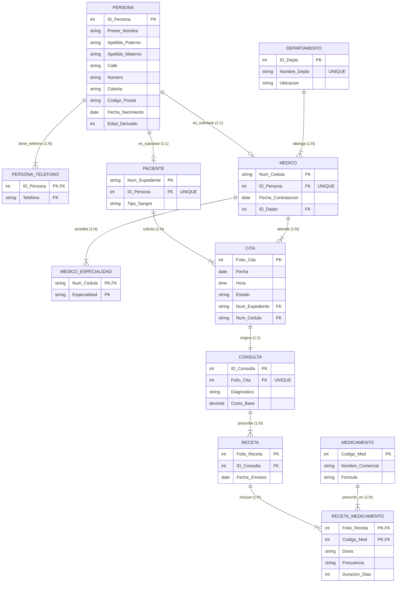

_Reporte Técnico de Transformación Relacional - Unidad 3_ 

<!-- Start of picture text -->
Tarea 3.1 | Say a; LICENC TECNOLOGICO NACIONAL DE MEXICO <!-- End of picture text -->

**REPORTE TÉCNICO: TRANSFORMACIÓN DE MODELO E-R A ESQUEMA RELACIONAL Y REGLAS DE INTEGRIDAD** 

**Asignatura:** Sistemas de Bases de Datos **Docente** : Ruben Miguel Riojas Rodríguez **Alumno:** Eduardo Salazar Martínez 

Tarea 3.1 | Asignatura: Sistemas de Bases de Datos | Clínica Salud Total 

_Reporte Técnico de Transformación Relacional - Unidad 3_ 

# **1. Planteamiento del Problema y Contexto de la Práctica** 

El presente reporte técnico documenta formalmente la transición desde el modelo conceptual EntidadRelación Extendido (EER) del sistema de información para la **Clínica Salud Total** (desarrollado en la Unidad 2) hacia un **Esquema Relacional Lógico** riguroso. La finalidad es estructurar la base de datos centralizada para erradicar las ineficiencias operativas causadas por la fragmentación de expedientes clínicos, traslapos en agendas médicas y descontrol en prescripciones farmacéuticas. 

# **2. Componentes Formales del Modelo Relacional y Restricciones de Integridad** 

El Modelo Relacional formaliza la representación de datos mediante estructuras matemáticas basadas en la teoría de conjuntos y la lógica de predicados. Sus componentes formales fundamentalmente son los siguientes: 

## **a) Componentes Formales Básicos:** 

- **Relación (Tabla):** Estructura bidimensional definida sobre un esquema R(A1, A2, ..., An) que representa un conjunto de datos ordenados lógicamente. 

- **Tupla (Fila/Registro):** Cada elemento u objeto individual dentro de una relación, correspondiente a una n-tupla ordenada de valores. 

- **Atributo (Columna/Campo):** Propiedad o característica nombrada que describe un aspecto de las tuplas de la relación. 

- **Dominio:** Conjunto genérico de valores atómicos homogéneos y válidos que un atributo determinado puede tomar (ej. fechas, números enteros positivos, cadenas de texto prefijadas). 

## **b) Reglas y Restricciones de Integridad Fundamental:** 

Las restricciones de integridad garantizan la consistencia, exactitud y validez de la información contenida en el SGBD: 

- **Integridad de Entidad:** Ningún atributo que forme parte de la llave primaria (Primary Key - PK) de una relación base puede asumir valores nulos (NULL). Esto garantiza que cada tupla sea identificable de manera única e inequívoca. 

- **Integridad Referencial:** Si una relación R2 contiene una llave foránea (Foreign Key - FK) que referencia a la llave primaria de una relación R1, todo valor de la FK en R2 debe coincidir exactamente con un valor existente de la PK en R1, o bien ser completamente nulo (si la regla de negocio permite opcionalidad). 

- **Integridad de Dominio:** Todo valor asignado a un atributo debe pertenecer estrictamente al conjunto de valores permitidos por su dominio asignado, respetando tipos de datos, rangos numéricos, listas de valores (CHECK constraints) y formatos estandarizados. 

Tarea 3.1 | Asignatura: Sistemas de Bases de Datos | Clínica Salud Total 

_Reporte Técnico de Transformación Relacional - Unidad 3_ 

# **3. Reglas de Conversión de Diagrama E-R/EER a Esquema Relacional** 

|**Componente E-R / EER**|**Regla de Conversión Relacional Aplicada**|**Caso Específico en Clínica** **Salud Total**|
|---|---|---|
|**Entidad Fuerte**|Se convierte directamente en una relación (tabla). Su llave primaria conceptual pasa a ser la PK de la relación.|DEPARTAMENTO(ID_Depto), MEDICAMENTO(Codigo_Med), CITA(Folio_Cita).|
|**Atributo Multivalorado**|Se descompone creando una tabla satélite subordinada. La PK de la nueva tabla es compuesta (FK hacia la entidad base + el atributo multivalorado).|PERSONA_TELEFONO(ID_Person a, Telefono) y MEDICO_ESPECIALIDAD(Num_Ce dula, Especialidad).|
|**Relación 1:N**|La llave primaria del lado '1' se propaga como Llave Foránea (FK) hacia la tabla del lado 'N'.|DEPARTAMENTO (1) -> MEDICO (N): ID_Depto se propaga como FK a MEDICO. PACIENTE (1) -> CITA (N): Num_Expediente a CITA.|
|**Relación 1:1**|Se propaga la PK de cualquiera de las entidades como FK a la otra (preferentemente hacia la entidad con participación total), incluyendo restricción UNIQUE.|CITA (1) -> CONSULTA (1): Folio_Cita se propaga a CONSULTA con restricción UNIQUE.|
|**Relación N:M**|Se crea una tabla de unión (intermedia) cuya PK es compuesta por las FKs de ambas entidades asociadas, más los atributos propios de la relación.|RECETA (N) <-> MEDICAMENTO (M): Origina RECETA_MEDICAMENTO(Folio_R eceta, Codigo_Med) con Dosis, Frecuencia y Duración.|
|**Jerarquía de Especialización** **(Disyuntiva y Total)**|Se adopta la estrategia de Múltiples Tablas con Subclases. La superclase PERSONA contiene atributos generales, mientras PACIENTE y MEDICO almacenan atributos específicos vinculados por ID_Persona (PK/FK UNIQUE).|PERSONA (Superclase) -> PACIENTE (Subclase) y MEDICO (Subclase). Ambos heredan ID_Persona como clave referencial obligatoria.|
|**Abstracción por Agregación**|La relación compuesta entre entidades (ej. Cita atendida entre Médico y Paciente) se trata como una unidad de abstracción de nivel superior vinculando la consulta y prescripción médica.|La agregación CITA genera la atención clínica interactiva CONSULTA y la posterior emisión de RECETA médica.|

Tarea 3.1 | Asignatura: Sistemas de Bases de Datos | Clínica Salud Total 

_Reporte Técnico de Transformación Relacional - Unidad 3_ 

# **4. Formulación Relacional Formal del Esquema** 

Tarea 3.1 | Asignatura: Sistemas de Bases de Datos | Clínica Salud Total 

_Reporte Técnico de Transformación Relacional - Unidad 3_ 

# **5. Esquema Tabular y Diccionario de Datos** 

A continuación se especifican en detalle los diccionarios de datos para cada una de las 11 relaciones del esquema relacional, definiendo los tipos de datos, longitudes, expresabilidad de nulos, tipos de clave, restricciones de integridad y descripción semántica: 

**Tabla 1: PERSONA (Entidad Superclase)** 

|**Campo**|**Tipo Dato**|**Longitud**|**Nulo**|**Clave**|**Restricciones / Default**|**Descripción Semántica**|
|---|---|---|---|---|---|---|
|**ID_Persona**|INT|4 bytes|NO|PK|AUTO_INCREMENT|Identificador único de persona.|
|**Primer_Nombre**|VARCHAR|50|NO|Ninguna|Texto alfabético|Primer nombre.|
|**Apellido_Paterno**|VARCHAR|50|NO|Ninguna|Texto alfabético|Apellido paterno.|
|**Apellido_Materno**|VARCHAR|50|SI|Ninguna|Texto alfabético|Apellido materno (opcional).|
|**Calle**|VARCHAR|100|NO|Ninguna|Dirección física|Nombre de la calle de residencia.|
|**Numero**|VARCHAR|20|NO|Ninguna|Num exterior e int|Número exterior/interior.|
|**Colonia**|VARCHAR|100|NO|Ninguna|Asentamiento|Colonia o fraccionamiento.|
|**Codigo_Postal**|VARCHAR|5|NO|Ninguna|Dígitos CP|Código postal de 5 dígitos.|
|**Fecha_Nacimiento**|DATE|3 bytes|NO|Ninguna|CHECK (Fecha < Actual)|Fecha de nacimiento.|
|**Edad_Derivado**|INT|4 bytes|SI|Ninguna|Atributo Calculado|Edad calculada (derivado).|

Tarea 3.1 | Asignatura: Sistemas de Bases de Datos | Clínica Salud Total 

_Reporte Técnico de Transformación Relacional - Unidad 3_ 

**Tabla 2: PERSONA_TELEFONO (Atributo Multivalorado)** 

|**Campo**|**Tipo Dato**|**Longitud**|**Nulo**|**Clave**|**Restricciones / Default**|**Descripción Semántica**|
|---|---|---|---|---|---|---|
|**ID_Persona**|INT|4 bytes|NO|PK / FK|FK -> PERSONA(ID_Persona)|Identificador de la persona.|
|**Telefono** **Tabla 3: PACIEN**|VARCHAR **TE (Subclase**|15 **Especializac**|NO **ión)**|PK|Dígitos telefónicos|Número de contacto telefónico.|
|**Campo**|**Tipo Dato**|**Longitud**|**Nulo**|**Clave**|**Restricciones / Default**|**Descripción Semántica**|
|**Num_Expediente**|VARCHAR|20|NO|PK|Formato 'EXP-XXXX'|Número único de expediente clínico.|
|**ID_Persona**|INT|4 bytes|NO|FK / UNQ|FK -> PERSONA(ID_Persona)|Vínculo obligatorio 1:1 a Persona.|
|**Tipo_Sangre**|VARCHAR|5|NO|Ninguna|CHECK (A+, O+, etc.)|Grupo sanguíneo y factor RH.|

**Tabla 4: MEDICO (Subclase Especialización)** 

|**Campo**|**Tipo Dato**|**Longitud**|**Nulo**|**Clave**|**Restricciones / Default**|**Descripción Semántica**|
|---|---|---|---|---|---|---|
|**Num_Cedula**|VARCHAR|20|NO|PK|Cédula profesional|Cédula profesional médica.|
|**ID_Persona**|INT|4 bytes|NO|FK / UNQ|FK -> PERSONA(ID_Persona)|Vínculo obligatorio 1:1 a Persona.|
|**Fecha_Contratacion**|DATE|3 bytes|NO|Ninguna|CHECK (Fecha <= Actual)|Fecha de ingreso a la clínica.|
|**ID_Depto**|INT|4 bytes|NO|FK|FK -> DEPARTAMENTO(ID_Depto )|Departamento de adscripción.|

Tarea 3.1 | Asignatura: Sistemas de Bases de Datos | Clínica Salud Total 

_Reporte Técnico de Transformación Relacional - Unidad 3_ 

**Tabla 5: MEDICO_ESPECIALIDAD (Atributo Multivalorado)** 

|**Campo**|**Tipo Dato**|**Longitud**|**Nulo**|**Clave**|**Restricciones / Default**|**Descripción Semántica**|
|---|---|---|---|---|---|---|
|**Num_Cedula**|VARCHAR|20|NO|PK / FK|FK -> MEDICO(Num_Cedula)|Cédula profesional del médico.|
|**Especialidad**|VARCHAR|100|NO|PK|Texto especialidad|Especialidad médica acreditada.|

**Tabla 6: DEPARTAMENTO** 

|**Campo**|**Tipo Dato**|**Longitud**|**Nulo**|**Clave**|**Restricciones / Default**|**Descripción Semántica**|
|---|---|---|---|---|---|---|
|**ID_Depto**|INT|4 bytes|NO|PK|AUTO_INCREMENT|Identificador único de departamento.|
|**Nombre_Depto**|VARCHAR|100|NO|UNIQUE|Texto único|Nombre del departamento clínico.|
|**Ubicacion**|VARCHAR|100|NO|Ninguna|Ubicación física|Piso o ala dentro de la clínica.|

**Tabla 7: CITA** 

|**Campo**|**Tipo Dato**|**Longitud**|**Nulo**|**Clave**|**Restricciones / Default**|**Descripción Semántica**|
|---|---|---|---|---|---|---|
|**Folio_Cita**|INT|4 bytes|NO|PK|AUTO_INCREMENT|Folio correlativo único de cita.|
|**Fecha**|DATE|3 bytes|NO|Ninguna|Fecha programada|Día asignado para la consulta.|
|**Hora**|TIME|3 bytes|NO|Ninguna|Horario laboral|Hora programada.|
|**Estado**|VARCHAR|20|NO|Ninguna|DEFAULT 'Programada'|Estado (Programada/Completad a/Cancelada).|
|**Num_Expediente**|VARCHAR|20|NO|FK|FK -> PACIENTE(Num_Expedient e)|Paciente que solicita la cita.|
|**Num_Cedula**|VARCHAR|20|NO|FK|FK -> MEDICO(Num_Cedula)|Médico asignado.|

Tarea 3.1 | Asignatura: Sistemas de Bases de Datos | Clínica Salud Total 

_Reporte Técnico de Transformación Relacional - Unidad 3_ 

**Tabla 8: CONSULTA (Agregación de Cita)** 

|**Campo**|**Tipo Dato**|**Longitud**|**Nulo**|**Clave**|**Restricciones / Default**|**Descripción Semántica**|
|---|---|---|---|---|---|---|
|**ID_Consulta**|INT|4 bytes|NO|PK|AUTO_INCREMENT|Identificador único de la consulta.|
|**Folio_Cita**|INT|4 bytes|NO|FK / UNQ|FK -> CITA(Folio_Cita)|Cita que origina la consulta médica.|
|**Diagnostico**|TEXT|Variable|NO|Ninguna|Min. 10 caracteres|Diagnóstico clínico detallado.|
|**Costo_Base**|DECIMAL|10,2|NO|Ninguna|CHECK (Costo_Base >= 0)|Costo financiero de la consulta.|

**Tabla 9: RECETA** 

|**Campo**|**Tipo Dato**|**Longitud**|**Nulo**|**Clave**|**Restricciones / Default**|**Descripción Semántica**|
|---|---|---|---|---|---|---|
|**Folio_Receta**|INT|4 bytes|NO|PK|AUTO_INCREMENT|Folio único de receta médica.|
|**ID_Consulta**|INT|4 bytes|NO|FK|FK ->|Consulta donde se emite|
||||||CONSULTA(ID_Consulta)|la receta.|
|**Fecha_Emision**|DATE|3 bytes|NO|Ninguna|DEFAULT CURRENT_DATE|Fecha de emisión.|

**Tabla 10: MEDICAMENTO** 

|**Campo**|**Tipo Dato**|**Longitud**|**Nulo**|**Clave**|**Restricciones / Default**|**Descripción Semántica**|
|---|---|---|---|---|---|---|
|**Codigo_Med**|INT|4 bytes|NO|PK|AUTO_INCREMENT|Código interno de medicamento.|
|**Nombre_Comercial**|VARCHAR|100|NO|Ninguna|Texto comercial|Nombre de marca.|
|**Formula**|VARCHAR|200|NO|Ninguna|Sustancia activa|Composición química / Fórmula.|

Tarea 3.1 | Asignatura: Sistemas de Bases de Datos | Clínica Salud Total 

_Reporte Técnico de Transformación Relacional - Unidad 3_ 

**Tabla 11: RECETA_MEDICAMENTO (Relación M:N)** 

|**Campo**|**Tipo Dato**|**Longitud**|**Nulo**|**Clave**|**Restricciones / Default**|**Descripción Semántica**|
|---|---|---|---|---|---|---|
|**Folio_Receta**|INT|4 bytes|NO|PK / FK|FK -> RECETA(Folio_Receta)|Receta que prescribe el medicamento.|
|**Codigo_Med**|INT|4 bytes|NO|PK / FK|FK -> MEDICAMENTO(Codigo_M ed)|Medicamento prescrito.|
|**Dosis**|VARCHAR|100|NO|Ninguna|Ej. '500 mg'|Cantidad por toma prescrita.|
|**Frecuencia**|VARCHAR|100|NO|Ninguna|Ej. 'Cada 8 horas'|Intervalo de administración.|
|**Duracion_Dias**|INT|4 bytes|NO|Ninguna|CHECK (Duracion_Dias > 0)|Días totales de tratamiento.|

# **6. Matriz de Cumplimiento con la Rúbrica de Evaluación** 

El presente trabajo ha sido diseñado para cumplir con el nivel Excelente (100%) de la rúbrica oficial de la asignatura: 

|**Criterio de Evaluación**|**Ponderación**|**Evidencia de Cumplimiento Técnico en Tarea 3.1**|
|---|---|---|
|**1. Corrección, Modelado Técnico y** **Lógica de Datos**|30%|Transformación exacta del diagrama EER a 11 relaciones sin pérdidas ni anomalías. Definición estricta de PKs, FKs y restricciones (NOT NULL, CHECK, UNIQUE, DEFAULT).|
|**4. Normalización, Eficiencia y Buenas** **Prácticas**|15%|Esquema llevado a 3FN. Eliminación total de atributos multivalorados mediante tablas satélite (PERSONA_TELEFONO, MEDICO_ESPECIALIDAD). Convención estandarizada de nombres.|
|**5. Reporte Técnico y Diccionario de** **Datos**|10%|Reporte estructurado con formulación relacional formal, reglas de negocio trazables, esquema tabular exhaustivo y justificación de integridad.|
|**6. Formato, Redacción y Entrega** **Puntual**|10%|Documentación formal en formato profesional, redacción técnica impecable y alineación total con la estructura solicitada en Teams.|

Tarea 3.1 | Asignatura: Sistemas de Bases de Datos | Clínica Salud Total 

_Reporte Técnico de Transformación Relacional - Unidad 3_ 

**Conclusión Técnica:** La conversión relacional desarrollada garantiza la integridad estructural y la trazabilidad de la información médica y administrativa de la Clínica Salud Total. Se preservan la abstracción de especialización (Persona) y agregación (Consulta) minimizando redundancias y facilitando la implementación física en SQL. 

Tarea 3.1 | Asignatura: Sistemas de Bases de Datos | Clínica Salud Total 

