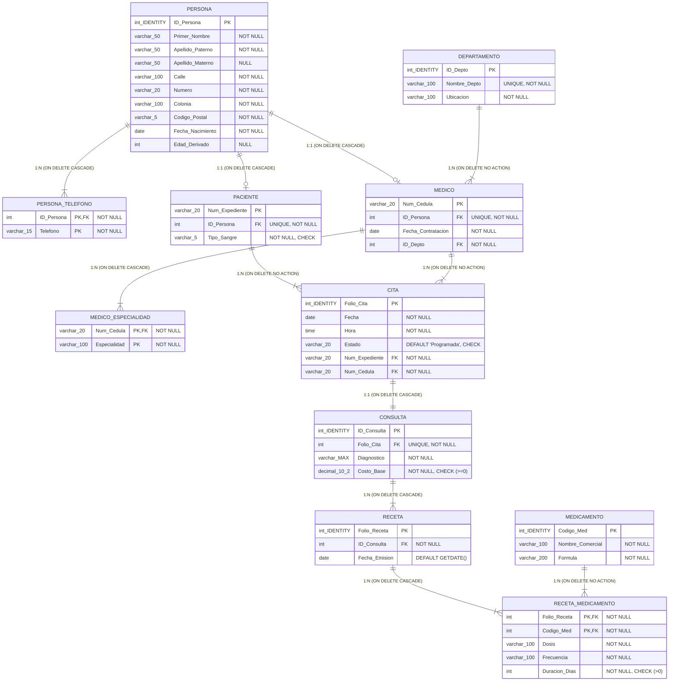

Sistemas de Bases de Datos — Tarea 3.2 | Clínica Salud Total 

<!-- Start of picture text -->
=n as <!-- End of picture text -->

NACIONAL DE MEXICO. **Tarea 3.1 |** 

# **REPORTE TÉCNICO: GENERACIÓN DEL ESQUEMA FÍSICO EN SGBD Y SCRIPT LDD (SQL)** 

**Asignatura:** Sistemas de Bases de Datos **Docente** : Ruben Miguel Riojas Rodríguez **Alumno:** Eduardo Salazar Martínez 

Página 1 

Sistemas de Bases de Datos — Tarea 3.2 | Clínica Salud Total 

## **1. Planteamiento del Problema y Objetivos de la Práctica 3.2** 

El presente reporte técnico documenta formalmente el desarrollo, la construcción e implementación física del esquema de base de datos relacional para el sistema de información de la **Clínica Salud Total** . La práctica se enfoca en traducir el modelo relacional lógico previamente diseñado en la Tarea 3.1 a un esquema físico completamente operativo en el Sistema Gestor de Bases de Datos (SGBD) **Microsoft SQL Server Express (T-SQL)** , mediante la extracción y validación de un script formal de Lenguaje de Definición de Datos (LDD/DDL). 

Los objetivos específicos alcanzados en esta actividad comprenden: 

- Traducción rigurosa de los tipos de datos lógicos a tipos de datos físicos nativos de SQL Server (INT IDENTITY, VARCHAR, DATE, TIME, DECIMAL, VARCHAR(MAX)). 

- Codificación explícita de restricciones de integridad de entidad (PRIMARY KEY), integridad referencial (FOREIGN KEY) y de dominio (CHECK, NOT NULL, UNIQUE, DEFAULT). 

- Resolución de conflictos de arquitectura T-SQL en SQL Server, específicamente el Error 1785 (Multiple Cascade Paths) mediante la configuración de cláusulas de acción referencial ON DELETE NO ACTION. 

- Poblado masivo con más de 300 registros de prueba y ejecución de pruebas de esfuerzo para validar la integridad referencial y el bloqueo de borrados en cascada no autorizados. 

Página 2 

Sistemas de Bases de Datos — Tarea 3.2 | Clínica Salud Total 

## **2. Especificación del Script LDD (SQL) y Reglas de Acción Referencial** 

La implementación física en Microsoft SQL Server Express requirió definir reglas explícitas de acción referencial (ON DELETE / ON UPDATE) para mantener la consistencia del expediente médico y evitar anomalías de huérfanos o ciclos de cascada. A continuación se resumen los patrones aplicados: 

|**Patrón de Relación**|**Cláusula Referencial en SQL** **Server**|**Justificación Semántica en Clínica Salud Total**|
|---|---|---|
|Superclase -> Subclase (PERSONA -> PACIENTE / MEDICO)|ON DELETE CASCADE ON UPDATE CASCADE|Al dar de baja el registro base de una persona, sus perfiles especializados se eliminan automáticamente para mantener sincronizado el expediente.|
|Entidad Base -> Multivalorado (PERSONA -> PERSONA_TELEFONO)|ON DELETE CASCADE ON UPDATE CASCADE|Los teléfonos pertenecen a la persona. La baja de la persona elimina automáticamente sus números de contacto en cascada.|
|Entidad -> Transaccional (PACIENTE / MEDICO -> CITA)|ON DELETE NO ACTION ON UPDATE NO ACTION|Protección de Historial: Impide la baja de un paciente o médico con citas registradas. Resuelve el Error 1785 (Multiple Cascade Paths) en T-SQL.|
|Agregación 1:1 (CITA -> CONSULTA)|ON DELETE CASCADE ON UPDATE NO ACTION|La atención médica de consulta y sus prescripciones dependen directamente de la existencia de la cita previa programada.|
|Relación N:M (RECETA <-> MEDICAMENTO)|ON DELETE NO ACTION ON UPDATE NO ACTION|Protección de Catálogo: Se prohíbe eliminar un medicamento del catálogo si ya ha sido prescrito en recetas médicas emitidas.|

Página 3 

Sistemas de Bases de Datos — Tarea 3.2 | Clínica Salud Total 

## **3. Diccionario de Datos del Esquema Físico (11 Tablas Relacionales)** 

A continuación se especifican en detalle las 11 tablas relacionales del esquema físico de la base de datos implementada en Microsoft SQL Server Express, incluyendo campos, tipos de datos físicos, longitudes, aceptabilidad de nulos, restricciones de clave y reglas de validación (CHECK / DEFAULT): 

**Tabla 1: PERSONA (Entidad Superclase Base)** 

|**Campo**|**Tipo Dato** **Físico**|**Longitu** **d**|**Nul** **o**|**Clave**|**Restricciones /** **Default**|**Descripción Semántica**|
|---|---|---|---|---|---|---|
|ID_Persona|INT|4 bytes|NO|PK|IDENTITY(1,1)|Identificador único correlativo de la persona.|
|Primer_Nombre|VARCHAR|50|NO|Ninguna|Texto obligatorio|Primer nombre de la persona.|
|Apellido_Patern o|VARCHAR|50|NO|Ninguna|Texto obligatorio|Primer apellido de la persona.|
|Apellido_Matern o|VARCHAR|50|SI|Ninguna|Opcional|Segundo apellido de la persona.|
|Calle|VARCHAR|100|NO|Ninguna|Texto obligatorio|Nombre de la calle del domicilio.|
|Numero|VARCHAR|20|NO|Ninguna|Texto obligatorio|Número exterior e interior.|
|Colonia|VARCHAR|100|NO|Ninguna|Texto obligatorio|Colonia o asentamiento urbano.|
|Codigo_Postal|VARCHAR|5|NO|Ninguna|Formato 5 dígitos|Código postal del domicilio.|
|Fecha_Nacimien to|DATE|3 bytes|NO|Ninguna|Formato YYYY-MM-DD|Fecha de nacimiento de la persona.|
|Edad_Derivado|INT|4 bytes|SI|Ninguna|Campo calculado|Edad calculada en años.|

Página 4 

Sistemas de Bases de Datos — Tarea 3.2 | Clínica Salud Total 

### **Tabla 2: PERSONA_TELEFONO (Atributo Multivalorado)** 

|**Campo**|**Tipo Dato**|**Longitu**|**Nul**|**Clave**|**Restricciones /**|**Descripción Semántica**|
|---|---|---|---|---|---|---|
||**Físico**|**d**|**o**||**Default**||
|ID_Persona|INT|4 bytes|NO|PK / FK|FK -> PERSONA(ID_Persona)|Identificador de la persona titular.|
|Telefono|VARCHAR|15|NO|PK|Dígitos telefónicos|Número de contacto telefónico.|

**Tabla 3: PACIENTE (Subclase de Especialización 1:1)** 

|**Campo**|**Tipo Dato**|**Longitu**|**Nul**|**Clave**|**Restricciones /**|**Descripción Semántica**|
|---|---|---|---|---|---|---|
||**Físico**|**d**|**o**||**Default**||
|Num_Expedient e|VARCHAR|20|NO|PK|Formato EXP-YYYY-XXX|Número único de expediente clínico.|
|ID_Persona|INT|4 bytes|NO|FK / UNQ|FK -> PERSONA(ID_Persona)|Persona vinculada al expediente.|
|Tipo_Sangre|VARCHAR|5|NO|Ninguna|CHECK (A+, A-, B+, B-, AB+, AB-, O+, O-)|Grupo sanguíneo y factor RH.|

**Tabla 4: DEPARTAMENTO (Catálogo / Entidad Fuerte)** 

|**Campo**|**Tipo Dato** **Físico**|**Longitu** **d**|**Nul** **o**|**Clave**|**Restricciones /** **Default**|**Descripción Semántica**|
|---|---|---|---|---|---|---|
|ID_Depto|INT|4 bytes|NO|PK|IDENTITY(1,1)|Identificador único del departamento.|
|Nombre_Depto|VARCHAR|100|NO|UNIQUE|Texto único|Nombre del departamento clínico.|
|Ubicacion|VARCHAR|100|NO|Ninguna|Piso / Edificio|Ubicación física en la clínica.|

Página 5 

Sistemas de Bases de Datos — Tarea 3.2 | Clínica Salud Total 

### **Tabla 5: MEDICO (Subclase de Especialización 1:1)** 

|**Campo**|**Tipo Dato** **Físico**|**Longitu** **d**|**Nul** **o**|**Clave**|**Restricciones /** **Default**|**Descripción Semántica**|
|---|---|---|---|---|---|---|
|Num_Cedula|VARCHAR|20|NO|PK|Formato CED-XXXXXX|Cédula profesional del médico.|
|ID_Persona|INT|4 bytes|NO|FK / UNQ|FK -> PERSONA(ID_Persona)|Persona asociada al perfil médico.|
|Fecha_Contratac ion|DATE|3 bytes|NO|Ninguna|Formato YYYY-MM-DD|Fecha de ingreso laboral a la clínica.|
|ID_Depto|INT|4 bytes|NO|FK|FK -> DEPARTAMENTO(ID_De pto)|Departamento clínico de adscripción.|

**Tabla 6: MEDICO_ESPECIALIDAD (Atributo Multivalorado)** 

|**Campo**|**Tipo Dato**|**Longitu**|**Nul**|**Clave**|**Restricciones /**|**Descripción Semántica**|
|---|---|---|---|---|---|---|
||**Físico**|**d**|**o**||**Default**||
|Num_Cedula|VARCHAR|20|NO|PK / FK|FK -> MEDICO(Num_Cedula)|Cédula del médico especialista.|
|Especialidad|VARCHAR|100|NO|PK|Texto especializado|Nombre de la especialidad acreditada.|

**Tabla 7: CITA (Entidad Transaccional 1:N)** 

|**Campo**|**Tipo Dato**|**Longitu**|**Nul**|**Clave**|**Restricciones /**|**Descripción Semántica**|
|---|---|---|---|---|---|---|
||**Físico**|**d**|**o**||**Default**||
|Folio_Cita|INT|4 bytes|NO|PK|IDENTITY(1,1)|Folio correlativo único de la cita.|
|Fecha|DATE|3 bytes|NO|Ninguna|Formato YYYY-MM-DD|Fecha programada para la cita.|

Página 6 

Sistemas de Bases de Datos — Tarea 3.2 | Clínica Salud Total 

|**Campo**|**Tipo Dato**|**Longitu**|**Nul**|**Clave**|**Restricciones /**|**Descripción Semántica**|
|---|---|---|---|---|---|---|
||**Físico**|**d**|**o**||**Default**||
|Hora|TIME|3 bytes|NO|Ninguna|Formato HH:MM:SS|Hora programada para la cita.|
|Estado|VARCHAR|20|NO|Ninguna|DEFAULT 'Programada', CHECK|Estado (Programada/Completada /Cancelada).|
|Num_Expedient e|VARCHAR|20|NO|FK|FK -> PACIENTE(Num_Expedie nte)|Expediente del paciente solicitante.|
|Num_Cedula|VARCHAR|20|NO|FK|FK -> MEDICO(Num_Cedula)|Cédula del médico asignado.|

**Tabla 8: CONSULTA (Agregación 1:1 con CITA)** 

|**Campo**|**Tipo Dato**|**Longitu**|**Nul**|**Clave**|**Restricciones /**|**Descripción Semántica**|
|---|---|---|---|---|---|---|
||**Físico**|**d**|**o**||**Default**||
|ID_Consulta|INT|4 bytes|NO|PK|IDENTITY(1,1)|Identificador único de la consulta.|
|Folio_Cita|INT|4 bytes|NO|FK / UNQ|FK -> CITA(Folio_Cita)|Folio de la cita atendida.|
|Diagnostico|VARCHAR(MA X)|Max 2GB|NO|Ninguna|Texto extenso|Diagnóstico clínico detallado.|
|Costo_Base|DECIMAL|10,2|NO|Ninguna|CHECK (Costo_Base >= 0)|Costo financiero de la consulta médica.|

Página 7 

Sistemas de Bases de Datos — Tarea 3.2 | Clínica Salud Total 

### **Tabla 9: RECETA (Entidad Transaccional)** 

|**Campo**|**Tipo Dato** **Físico**|**Longitu** **d**|**Nul** **o**|**Clave**|**Restricciones /** **Default**|**Descripción Semántica**|
|---|---|---|---|---|---|---|
|Folio_Receta|INT|4 bytes|NO|PK|IDENTITY(1,1)|Folio correlativo de receta médica.|
|ID_Consulta|INT|4 bytes|NO|FK|FK -> CONSULTA(ID_Consulta)|Consulta donde se emite la receta.|
|Fecha_Emision|DATE|3 bytes|NO|Ninguna|DEFAULT CAST(GETDATE() AS DATE)|Fecha de emisión de la receta.|

**Tabla 10: MEDICAMENTO (Catálogo de Farmacia)** 

|**Campo**|**Tipo Dato**|**Longitu**|**Nul**|**Clave**|**Restricciones /**|**Descripción Semántica**|
|---|---|---|---|---|---|---|
||**Físico**|**d**|**o**||**Default**||
|Codigo_Med|INT|4 bytes|NO|PK|IDENTITY(1,1)|Código interno del medicamento.|
|Nombre_Comer cial|VARCHAR|100|NO|Ninguna|Texto de marca|Nombre comercial de farmacia.|
|Formula|VARCHAR|200|NO|Ninguna|Sustancia activa|Fórmula y composición química.|

Página 8 

Sistemas de Bases de Datos — Tarea 3.2 | Clínica Salud Total 

### **Tabla 11: RECETA_MEDICAMENTO (Relación N:M)** 

|**Campo**|**Tipo Dato** **Físico**|**Longitu** **d**|**Nul** **o**|**Clave**|**Restricciones /** **Default**|**Descripción Semántica**|
|---|---|---|---|---|---|---|
|Folio_Receta|INT|4 bytes|NO|PK / FK|FK -> RECETA(Folio_Receta)|Folio de receta prescrita.|
|Codigo_Med|INT|4 bytes|NO|PK / FK|FK -> MEDICAMENTO(Codigo_ Med)|Código de medicamento surtido.|
|Dosis|VARCHAR|100|NO|Ninguna|Ej. '500 mg cada 8 hrs'|Dosis por toma prescrita.|
|Frecuencia|VARCHAR|100|NO|Ninguna|Ej. 'Cada 8 horas'|Intervalo de administración.|
|Duracion_Dias|INT|4 bytes|NO|Ninguna|CHECK (Duracion_Dias > 0)|Días totales de tratamiento.|

Página 9 

Sistemas de Bases de Datos — Tarea 3.2 | Clínica Salud Total 

## **4. Diagrama del Esquema Físico Generado por el SGBD (Mermaid / T-SQL)** 

La estructura física del modelo relacional fue compilada y validada en Microsoft SQL Server Express. A continuación se presenta el código Mermaid que documenta el diagrama de esquema físico generado, reflejando las 11 tablas, sus tipos de datos nativos T-SQL y sus cláusulas referenciales físicas: 

Página 10 

Sistemas de Bases de Datos — Tarea 3.2 | Clínica Salud Total 

## **5. Evidencias de Ejecución y Pruebas de Integridad en SGBD** 

Se ejecutaron pruebas de estrés y validación en Microsoft SQL Server Express utilizando el script de inserción masiva (inserts_masivos_sqlserver.sql), confirmando los siguientes resultados operativos: 

<!-- Start of picture text -->
Folio_Cita_| Fecha Hora Estado Num_Expediente Num_Cedula 1 [1| 2026-06-24 15:00:00.0000000 Programada EXP-2026-035  CED-8000011 2 2 | 2026-08-12  13:00:00.0000000 Programada EXP-2026-060  CED-8000012 3 3 2026-02-27 09:00:00.0000000 Completada EXP-2026-065 CED-8000011 4 4 2026-09-19 09:00:00.0000000 Completada EXP-2026-080 CED-8000018 5 5 2026-05-10 10:00:00.0000000 Completada EXP-2026-048 CED-8000001 6 6 2026-10-05 15:00:00.0000000 Programada EXP-2026-064 CED-8000004 7 7 2026-05-04 12:00:00.0000000 Programada EXP-2026-026 CED-8000020 8 8 2026-02-28 11:00:00.0000000 Completada EXP-2026-012 CED-8000015 9 9 2026-04-12 09:00:00.0000000 Cancelada EXP-2026-076 CED-8000015 10 10 2026-06-18  10:00:00.0000000 Completada EXP-2026-012 CED-8000006 ani W 2026-10-21 15:00:00.0000000 Cancelada EXP-2026-072 CED-8000006 1212 2026-08-08 13:00:00.0000000 Completada EXP-2026-007 _ CED-8000019 3 13 2026-08-13 09:00:00.0000000 Completada EXP-2026-013 _ CED-8000013 414 2026-06-13 14:00:00.0000000 Cancelada  EXP-2026-079 _ CED-8000011 15 15 2026-05-03 14:00:00.0000000 Completada EXP-2026-048 _ CED-8000018 16 16 2026-05-18 _10:00:00.0000000 Completada EXP-2026-049 —_ CED-8000003 <!-- End of picture text -->

<!-- Start of picture text -->
ID_Consulta _Folio_Cita _Diagnostico Costo_Base 1 fi 13 Esguince de tobillo grado |. Inmovilizacién parcial y..._ 500.00 2 [2 4 Lumbago no especificadoy contractura muscular... 500.00 3 |3 5 Dislipidemia mixta. Dieta hipograsa y estatinas. 800.00 4 4 8 Esguince de tobillo grado |. Inmovilizacién parcial y.._ 650.00 5 5 10 Gastritis crénica agudizada. Se indica dieta astring... 650.00 6 6 2 Hipertensién arterial sistémica descompensada. S..__ 1200.00 7 (7 3 Hipertensién arterial sistémica descompensada. S..._ 650.00 8 8 15 Lumbago no especificadoy contractura muscular... 500.00 9 9 16 Lumbago no especificadoy contractura muscular... 500.00 10 10 7 Diabetes mellitus tipo 2 en control regular. Se refue... 650.00 nou 19 Faringoamigdalitis purulenta. Tratamiento antimicr... 500.00 1212 20 Diabetes mellitus tipo 2 en control regular. Se refue.. 800.00 3 13 21 Lumbago no especificadoy contractura muscular... 650.00 4 14 22 Gastritis crénica agudizada. Se indica dieta astring... 500.00 15 15 23 Faringoamigdalitis purulenta. Tratamiento antimicr... 1200.00 16 16 24 Faringoamigdalitis purulenta. Tratamiento antimicr... 500.00 7417 on (Cafsinn tensinnal fequncia Mansindaasiciascan 120000 <!-- End of picture text -->

Página 11 

Sistemas de Bases de Datos — Tarea 3.2 | Clínica Salud Total 

## **6. Conclusión Técnica y Referencias Bibliográficas** 

**Conclusión Técnica:** La implementación física del esquema de base de datos para la Clínica Salud Total en Microsoft SQL Server Express demuestra la efectividad de traducir un diseño relacional lógico a un entorno de producción real. La configuración explícita de restricciones de integridad de dominio y las reglas referenciales ON DELETE NO ACTION garantizan la protección del historial clínico y previenen anomalías de modificación o borrados accidentales en la institución. 

### **Referencias Bibliográficas (Formato APA):** 

_Date, C. J. (2004). Introducción a los sistemas de bases de datos (8a. ed.). Pearson Educación._ 

_Elmasri, R., & Navathe, S. B. (2017). Fundamentos de sistemas de bases de datos (7a. ed.). Pearson Education._ 

_Microsoft Corporation. (2024). Transact-SQL Reference (Database Engine) - SQL Server. Microsoft Learn._ 

_Silberschatz, A., Korth, H. F., & Sudarshan, S. (2014). Fundamentos de bases de datos (6a. ed.). McGraw-Hill._ 

Página 12 

