# Unidad 5: Álgebra Relacional
## Catálogo de Actividades y Documentación Técnica de la Unidad 5

---

### 📌 Información Institucional y del Estudiante

| Campo | Detalle |
| :--- | :--- |
| **Institución:** | Tecnológico Nacional de México |
| **Materia:** | Fundamentos de Bases de Datos |
| **Unidad:** | Unidad 5 – Lenguajes de Consulta Formales (Álgebra Relacional) |
| **Docente:** | Ruben Miguel Riojas Rodríguez |
| **Alumno:** | Eduardo Salazar Martínez |
| **Repositorio:** | `Eduardo13458 / Tareas-fundamentos-de-base-de-datos-` |
| **Directorio Base:** | `Actividades Base de datos/Unidad 5/` |

---

## 🗺️ 1. Índice de Navegación de la Unidad 5

Este documento funge como índice general, marco explicativo y punto de acceso directo a todos los archivos y recursos desarrollados en las dos actividades de la **Unidad 5**:

```text
📁 Actividades Base de datos/Unidad 5/
├── 📄 README.md                                          <- Índice general y catálogo técnico de la Unidad 5.
│
├── 📁 Unidad 5.1/                                        <- Actividad 5.1: Operadores del Álgebra Relacional
│   ├── 📑 reporte_tarea_5_1_algebra_relacional_v2 (1).md <- Reporte técnico formal en Markdown
│   ├── 📑 reporte_tarea_5_1_algebra_relacional_v2.pdf    <- Reporte técnico en formato PDF
│   ├── 📊 mapa_conceptual_mermaid.txt                   <- Código fuente del mapa conceptual (Mermaid)
│   └── 🎥 Video Explicativo en YouTube                  <- Exposición grabada (Notación y Operadores)
│
└── 📁 Unidad 5.2/                                        <- Actividad 5.2: Consultas Formales sobre Esquema Relacional
    ├── 📑 reporte_tarea_5_2_algebra_relacional.pdf       <- Reporte técnico formal con las 10 consultas
    ├── 💾 clinica_consultas_algebra_relacional.sql       <- Script DDL, DML y consultas (SQL Server / ANSI)
    └── 🎥 Video Explicativo en YouTube                  <- Demostración de consultas complejas
```

---

## 📑 2. Actividad 5.1: Operadores Fundamentales y Extendidos del Álgebra Relacional

### 🔗 Enlaces a los Archivos en el Repositorio
* **Directorio de la Actividad:** [`📁 Unidad 5.1/`](./Unidad%205.1/)
* **Reporte Técnico (Markdown):** [`📑 reporte_tarea_5_1_algebra_relacional_v2 (1).md`](https://github.com/Eduardo13458/Tareas-fundamentos-de-base-de-datos-/blob/main/Actividades%20Base%20de%20datos/Unidad%205/Unidad%205.1/reporte_tarea_5_1_algebra_relacional_v2%20(1).md)
* **Reporte Técnico (PDF):** [`📑 reporte_tarea_5_1_algebra_relacional_v2.pdf`]([./Unidad%205.1/reporte_tarea_5_1_algebra_relacional_v2.pdf](https://github.com/Eduardo13458/Tareas-fundamentos-de-base-de-datos-/blob/main/Actividades%20Base%20de%20datos/Unidad%205/Unidad%205.1/reporte_tarea_5_1_algebra_relacional_v2.pdf))
* **Video Explicativo:** `[Enlace a YouTube]` *(Video público con webcam en esquina inferior derecha)*

### 📖 Marco Teórico y Notación Formal

El álgebra relacional es un lenguaje procedimental cerrado donde cada operación toma relaciones de entrada y genera una nueva relación resultante.

#### A. Operadores Unarios
1. **Selección ($\sigma$):** $\sigma_{\theta}(R) = \{ t \in R \mid \theta(t) = \text{Verdadero} \}$
   * Filtro horizontal que evalúa el predicado lógico $\theta$ en cada tupla, conservando todos los atributos originales.
2. **Proyección ($\pi$):** $\pi_{A_1, \dots, A_k}(R) = \{ t[A_1, \dots, A_k] \mid t \in R \}$
   * Filtro vertical que extrae exclusivamente las columnas indicadas, eliminando automáticamente tuplas duplicadas.

#### B. Operadores Binarios y Derivados
3. **Producto Cartesiano ($\times$):** $R \times S = \{ t \cdot q \mid t \in R \land q \in S \}$
   * Combina todas las tuplas de $R$ con todas las tuplas de $S$. Base formal de las reuniones.
4. **Operadores de Conjuntos ($\cup, \cap, -$):**
   * Exigen **compatibilidad de unión** (mismo grado y dominios compatibles).
   * **Unión ($\cup$):** Retorna tuplas presentes en $R$, en $S$ o en ambas relaciones.
   * **Intersección ($\cap$):** Retorna tuplas que coexisten simultáneamente en $R$ y en $S$. Derivado: $R \cap S = R - (R - S)$.
   * **Diferencia ($-$):** Retorna tuplas que pertenecen a $R$ pero no existen en $S$.
5. **Reunión / Join ($\bowtie$):** Combina tuplas relacionadas.
   * *Theta Join ($\bowtie_{\theta}$):* $\sigma_{\theta}(R \times S)$.
   * *Natural Join ($\bowtie$):* Empareja atributos homónimos suprimiendo columnas redundantes.
6. **División ($\div$):** $R \div S = \pi_X(R) - \pi_X((\pi_X(R) \times S) - R)$.
   * Selecciona tuplas de $R$ que están asociadas con **todas** las tuplas de $S$.

#### C. Álgebra Relacional Extendida
7. **Proyección Generalizada:** $\pi_{F_1, \dots, F_n}(R)$, admite cálculos aritméticos y funciones sobre atributos.
8. **Funciones de Agregación ($\mathcal{G}$):** $_{G_1, \dots, G_m}\mathcal{G}_{f_1(A_1), \dots, f_k(A_k)}(R)$, agrupa por atributos $G$ y calcula estadísticos (`SUM`, `AVG`, `COUNT`, `MIN`, `MAX`).
9. **Reuniones Externas (Outer Joins):** Left Outer Join ($\text{ }⟕\text{ }$), Right Outer Join ($\text{ }⟖\text{ }$) y Full Outer Join ($\text{ }⟗\text{ }$), preservando tuplas sin coincidencia con valores nulos (`NULL`).

### 🗺️ Mapa Conceptual de la Actividad 5.1

```mermaid
graph TD
    AR["<b>ÁLGEBRA RELACIONAL</b><br/>(Lenguaje Procedural de Consulta)"]

    AR --> OP_FUND["<b>Operadores Fundamentales</b><br/>(Primitivos)"]
    AR --> OP_DERIV["<b>Operadores Derivados</b><br/>(Expresables con Primitivos)"]
    AR --> OP_EXT["<b>Álgebra Relacional Extendida</b><br/>(Capacidades Prácticas de Consulta)"]

    OP_FUND --> OP_UNARIOS["<b>Unarios</b>"]
    OP_FUND --> OP_BINARIOS["<b>Binarios</b>"]

    OP_UNARIOS --> SEL["<b>Selección (σ)</b><br/><i>σ_θ(R)</i><br/>Filtro horizontal de tuplas"]
    OP_UNARIOS --> PROY["<b>Proyección (π)</b><br/><i>π_{A}(R)</i><br/>Filtro vertical de columnas"]

    OP_BINARIOS --> PC["<b>Producto Cartesiano (×)</b><br/><i>R × S</i><br/>Combinación cruzada de tuplas"]
    OP_BINARIOS --> UNI["<b>Unión (∪)</b><br/><i>R ∪ S</i><br/>Fusión de conjuntos compatibles"]
    OP_BINARIOS --> DIF["<b>Diferencia (-)</b><br/><i>R - S</i><br/>Tuplas exclusivas de la primera relación"]

    OP_DERIV --> INT["<b>Intersección (∩)</b><br/><i>R ∩ S = R - (R - S)</i><br/>Coincidencia en ambos conjuntos"]
    OP_DERIV --> DIV["<b>División (÷)</b><br/><i>R ÷ S</i><br/>Correspondencia universal completa"]
    OP_DERIV --> JOIN["<b>Reunión / Join (⋈)</b><br/><i>R ⋈_θ S = σ_θ(R × S)</i><br/>Combinación condicional"]

    JOIN --> THETA["<b>Theta Join (⋈_θ)</b><br/>Condición arbitraria θ"]
    JOIN --> NAT["<b>Natural Join (⋈)</b><br/>Igualdad en atributos homónimos"]

    OP_EXT --> PROY_GEN["<b>Proyección Generalizada</b><br/><i>π_{F}(R)</i><br/>Cálculos aritméticos y expresiones"]
    OP_EXT --> FUNC_AGR["<b>Funciones de Agregación (G)</b><br/><i>_G G _f(A)(R)</i><br/>SUM, AVG, COUNT, MIN, MAX"]
    OP_EXT --> OUTER_JOIN["<b>Reuniones Externas (Outer Joins)</b><br/>Preservación con valores NULL"]

    OUTER_JOIN --> LEFT["<b>Left Outer Join (⟕)</b><br/>Preserva tabla izquierda"]
    OUTER_JOIN --> RIGHT["<b>Right Outer Join (⟖)</b><br/>Preserva tabla derecha"]
    OUTER_JOIN --> FULL["<b>Full Outer Join (⟗)</b><br/>Preserva ambas tablas"]

    classDef main fill:#1e3a8a,stroke:#3b82f6,stroke-width:2px,color:#ffffff;
    classDef branch fill:#1f2937,stroke:#60a5fa,stroke-width:2px,color:#ffffff;
    classDef op fill:#065f46,stroke:#34d399,stroke-width:1px,color:#ffffff;
    classDef subop fill:#374151,stroke:#9ca3af,stroke-width:1px,color:#ffffff;

    class AR main;
    class OP_FUND,OP_DERIV,OP_EXT branch;
    class OP_UNARIOS,OP_BINARIOS,SEL,PROY,PC,UNI,DIF,INT,DIV,JOIN,PROY_GEN,FUNC_AGR,OUTER_JOIN op;
    class THETA,NAT,LEFT,RIGHT,FULL subop;
```



---

## 📑 3. Actividad 5.2: Resolución de Consultas sobre el Esquema Relacional con Álgebra Formal

### 🔗 Enlaces a los Archivos en el Repositorio
* **Directorio de la Actividad:** [`📁 Unidad 5.2/`](./Unidad%205.2/)
* **Reporte Técnico (PDF):** [`📑 reporte_tarea_5_2_algebra_relacional.pdf`](./Unidad%205.2/reporte_tarea_5_2_algebra_relacional.pdf)
* **Script de Base de Datos (SQL Server):** [`💾 clinica_consultas_algebra_relacional.sql`](./Unidad%205.2/clinica_consultas_algebra_relacional.sql)
* **Video Explicativo:** `[Enlace a YouTube]` *(Demostración de 3 consultas complejas)*

### 🏥 Esquema Relacional (Clínica Médica Hospitalaria en 3FN)

* **`PACIENTE`** (`id_paciente`, `nombre`, `apellido`, `fecha_nacimiento`, `genero`, `telefono`, `ciudad`)
* **`ESPECIALIDAD`** (`id_especialidad`, `nombre_especialidad`, `area_hospital`)
* **`MEDICO`** (`id_medico`, `nombre`, `apellido`, `id_especialidad`, `telefono`, `salario`)
* **`CITA`** (`id_cita`, `id_paciente`, `id_medico`, `fecha`, `hora`, `estado`, `costo`)
* **`TRATAMIENTO`** (`id_tratamiento`, `nombre_tratamiento`, `costo_tratamiento`, `duracion_dias`)
* **`HISTORIAL_CLINICO`** (`id_historial`, `id_paciente`, `id_medico`, `fecha_diagnostico`, `diagnostico`, `id_tratamiento`)

### 📋 Catálogo Sintético de las 10 Consultas Resueltas

| # | Operación Formal | Requerimiento en Lenguaje Natural | Expresión Formal en Álgebra Relacional |
| :-: | :--- | :--- | :--- |
| **1** | Selección ($\sigma$) | Pacientes que residen en Monterrey | $\sigma_{\text{ciudad} = '\text{Monterrey}'}(\text{PACIENTE})$ |
| **2** | Proyección ($\pi$) | Directorio salarial de médicos | $\pi_{\text{id\_medico}, \text{nombre}, \text{apellido}, \text{salario}}(\text{MEDICO})$ |
| **3** | Join + Selección | Pacientes con citas completadas | $\pi_{\text{nombre}, \text{apellido}}(\sigma_{\text{estado}='Completada'}(\text{CITA}) \bowtie \text{PACIENTE})$ |
| **4** | Join Multitabla | Citas con datos de paciente, médico y especialidad | $\pi_{\text{fecha}, \text{hora}, \text{P.nombre}, \text{M.nombre}, \text{E.nombre}}(\text{CITA} \bowtie \text{P} \bowtie \text{M} \bowtie \text{E})$ |
| **5** | Diferencia ($-$) | Pacientes registrados que nunca agendaron cita | $\pi_{\text{id, nom, ape}}(\text{PACIENTE}) - \pi_{\text{id, nom, ape}}(\text{PACIENTE} \bowtie \text{CITA})$ |
| **6** | Unión ($\cup$) | Directorio unificado de teléfonos | $\pi_{\text{nom, ape, tel}}(\text{PACIENTE}) \cup \pi_{\text{nom, ape, tel}}(\text{MEDICO})$ |
| **7** | Proy. Generalizada | Citas > 500 con descuento del 15% | $\pi_{\text{id\_cita}, \text{costo}, \text{costo} \times 0.85 \rightarrow \text{costo\_seguro}}(\sigma_{\text{costo} > 500}(\text{CITA}))$ |
| **8** | Agregación ($\mathcal{G}$) | Total ingresos, promedio y total citas por médico | $_{\text{id\_medico}}\mathcal{G}_{\text{SUM(costo)}, \text{AVG(costo)}, \text{COUNT(cita)}}(\text{CITA})$ |
| **9** | Left Join ($\text{ }⟕\text{ }$) | Directorio de médicos incluyendo los que no tienen citas | $\pi_{\text{M.id}, \text{M.nombre}, \text{C.id\_cita}}(\text{MEDICO} \text{ }⟕\text{ } \text{CITA})$ |
| **10**| División ($\div$) | Pacientes atendidos por todos los cardiólogos | $\pi_{\text{id\_paciente}, \text{id\_medico}}(\text{CITA}) \div \pi_{\text{id\_medico}}(\sigma_{\text{esp}='Cardiología'}(\text{MED} \bowtie \text{ESP}))$ |

---

## 📚 4. Referencias Bibliográficas (Formato APA 7.ª ed.)

* Codd, E. F. (1970). A relational model of data for large shared data banks. *Communications of the ACM*, 13(6), 377–387.
* Elmasri, R., & Navathe, S. B. (2017). *Fundamentos de sistemas de bases de datos* (7.ª ed.). Pearson Educación.
* Silberschatz, A., Korth, H. F., & Sudarshan, S. (2014). *Fundamentos de bases de datos* (6.ª ed.). McGraw-Hill Education.
