# Unidad 6: Lenguaje de Consulta Estructurado (SQL)
## Actividad 6.1: Sintaxis y Clasificación de Sentencias SQL (LDD y LMD)

---

### 📌 Información Institucional y del Estudiante

| Campo | Detalle |
| :--- | :--- |
| **Institución:** | Tecnológico Nacional de México |
| **Materia:** | Sistemas de Bases de Datos / Fundamentos de Bases de Datos |
| **Unidad:** | Unidad 6 – Lenguaje de Definición y Manipulación de Datos (SQL) |
| **Docente:** | Ruben Miguel Riojas Rodríguez |
| **Alumno:** | Eduardo Salazar Martínez |
| **Repositorio GitHub:** | [Eduardo13458 / Tareas-fundamentos-de-base-de-datos-](https://github.com/Eduardo13458/Tareas-fundamentos-de-base-de-datos-) |
| **Directorio de la Actividad:** | [`Actividades Base de datos/Unidad 6/Unidad 6.1/`](https://github.com/Eduardo13458/Tareas-fundamentos-de-base-de-datos-/tree/main/Actividades%20Base%20de%20datos/Unidad%206/Unidad%206.1) |
| **Video en YouTube:** | `[Inserta aquí tu enlace público de YouTube]` *(Exposición explicando la sintaxis y comportamiento de sentencias LDD y LMD)* |

---

## 🗂️ 1. Índice de Archivos de la Actividad 6.1

Los siguientes enlaces conectan directamente con los entregables de la actividad dentro de este directorio en el repositorio (verificados para evitar errores 404):

| Archivo | Tipo | Enlace Relativo Local  | Enlace Completo (GitHub) |
| :--- | :---: | :---: | :---: |
| **`tarea 6.1Sintaxis y Clasificación de Sentencias SQL (LDD y LMD) (1).md`** | Markdown | [📄 Abrir Reporte Markdown](./tarea%206.1Sintaxis%20y%20Clasificaci%C3%B3n%20de%20Sentencias%20SQL%20(LDD%20y%20LMD)%20(1).md) | [Ver en GitHub](https://github.com/Eduardo13458/Tareas-fundamentos-de-base-de-datos-/blob/main/Actividades%20Base%20de%20datos/Unidad%206/Unidad%206.1/tarea%206.1Sintaxis%20y%20Clasificaci%C3%B3n%20de%20Sentencias%20SQL%20(LDD%20y%20LMD)%20(1).md) |
| **`tarea 6.1Sintaxis y Clasificación de Sentencias SQL (LDD y LMD).pdf`** | PDF | [📑 Abrir Reporte PDF](./tarea%206.1Sintaxis%20y%20Clasificaci%C3%B3n%20de%20Sentencias%20SQL%20(LDD%20y%20LMD).pdf) | [Ver en GitHub](https://github.com/Eduardo13458/Tareas-fundamentos-de-base-de-datos-/blob/main/Actividades%20Base%20de%20datos/Unidad%206/Unidad%206.1/tarea%206.1Sintaxis%20y%20Clasificaci%C3%B3n%20de%20Sentencias%20SQL%20(LDD%20y%20LMD).pdf) |

---

## 📖 2. Fundamentos y Características del Lenguaje SQL

El **Lenguaje de Consulta Estructurado** (*SQL - Structured Query Language*) constituye el estándar de facto internacional (normas ANSI e ISO) para la definición, manipulación y administración de sistemas de gestión de bases de datos relacionales (SGBD).

### Pilares Fundamentales:
1. **Naturaleza Declarativa:** A diferencia de los lenguajes procedimentales, el operador especifica **qué datos requiere** o qué modificaciones aplicar, dejando al **Optimizador de Consultas (Query Optimizer)** del motor la tarea de decidir el plan de ejecución más eficiente.
2. **Tipado Fuerte e Integridad de Datos:**
   * **Integridad de Dominio:** Validación de rangos y tipos de datos (`INT`, `VARCHAR`, `DECIMAL`, restricciones `CHECK` y `NOT NULL`).
   * **Integridad de Entidad:** Identificación unívoca de tuplas mediante Clave Primaria (`PRIMARY KEY`).
   * **Integridad Referencial:** Coherencia relacional mediante Claves Foráneas (`FOREIGN KEY`) y políticas en cascada.
3. **Control Transaccional (Propiedades ACID):** Asegura que las operaciones de manipulación cumplan con **Atomicidad, Consistencia, Aislamiento (Isolation) y Durabilidad**.

---

## ⚖️ 3. Taxonomía Comparativa: LDD (DDL) vs. LMD (DML)

| Criterio Taxonómico | Lenguaje de Definición de Datos (LDD / DDL) | Lenguaje de Manipulación de Datos (LMD / DML) |
| :--- | :--- | :--- |
| **Objetivo Principal** | Definir, modificar y estructurar los objetos y el esquema de la base de datos. | Consultar, insertar, actualizar y eliminar registros almacenados dentro de las tablas. |
| **Sentencias Clave** | `CREATE`, `ALTER`, `DROP`, `TRUNCATE`, `RENAME` | `SELECT`, `INSERT`, `UPDATE`, `DELETE` |
| **Nivel de Operación** | Metadatos, estructuras de tablas, índices, esquemas y almacenamiento físico. | Tuplas o registros individuales y conjuntos de datos alojados en las tablas. |
| **Transaccionalidad** | *Auto-commit* implícito en la mayoría de SGBD (modificación inmediata de esquema). | Transaccional explícito (soporta `BEGIN`, `COMMIT` y `ROLLBACK`). |
| **Disparo de Triggers** | Dispara DDL Triggers a nivel de servidor o base de datos. | Dispara DML Triggers de tabla (`BEFORE`, `AFTER`, `INSTEAD OF`). |
| **Gestión de Espacio** | Asigna, modifica o desasigna páginas físicas de memoria y almacenamiento. | Modifica el contenido de las páginas de datos existentes sin alterar el esquema. |

> 📌 **Regla Mnemotécnica Estructural:** LDD actúa sobre la **infraestructura o contenedor** (la 'caja'), mientras que LMD opera sobre el **contenido líquido** que reside en dicha caja.

---

## 🛠️ 4. Sintaxis Formal de Comandos

### A. Sentencias de Definición de Datos (LDD / DDL)

* **`CREATE TABLE`:**
  ```sql
  CREATE TABLE [IF NOT EXISTS] nombre_tabla (
      columna1 tipo_dato [RESTRICCIONES_COLUMNA],
      columna2 tipo_dato [RESTRICCIONES_COLUMNA],
      [CONSTRAINT nombre_restriccion] RESTRICCION_TABLA (columnas)
  );
  ```
* **`ALTER TABLE`:**
  ```sql
  ALTER TABLE nombre_tabla
      ADD columna tipo_dato [RESTRICCIONES]
      | DROP COLUMN columna [CASCADE | RESTRICT]
      | ALTER COLUMN columna tipo_dato;
  ```
* **`DROP TABLE`:**
  ```sql
  DROP TABLE [IF EXISTS] nombre_tabla [CASCADE | RESTRICT];
  ```
* **`TRUNCATE TABLE`:**
  ```sql
  TRUNCATE TABLE nombre_tabla [RESTART IDENTITY | CONTINUE IDENTITY];
  ```

---

### B. Sentencias de Manipulación de Datos (LMD / DML)

* **`INSERT INTO`:**
  ```sql
  INSERT INTO nombre_tabla (columna1, columna2)
  VALUES (valor1, valor2);
  ```
* **`UPDATE`:**
  ```sql
  UPDATE nombre_tabla
  SET columna1 = nuevo_valor
  WHERE condicion;
  ```
* **`DELETE`:**
  ```sql
  DELETE FROM nombre_tabla
  WHERE condicion;
  ```
* **`SELECT`:**
  ```sql
  SELECT [DISTINCT] columnas
  FROM tabla1
  [INNER | LEFT | RIGHT JOIN tabla2 ON condicion_union]
  [WHERE condicion_filtro]
  [GROUP BY columnas_agrupacion]
  [HAVING condicion_grupos]
  [ORDER BY columna [ASC | DESC]];
  ```

---

## 🔍 5. Matriz Comparativa Crítica: `DROP` vs. `TRUNCATE` vs. `DELETE`

| Dimensión Técnica | `DROP TABLE` | `TRUNCATE TABLE` | `DELETE FROM` |
| :--- | :--- | :--- | :--- |
| **Categoría SQL** | LDD / DDL | LDD / DDL | LMD / DML |
| **Efecto Estructural** | Destruye la tabla, metadatos, índices y permisos. | Conserva la estructura y el esquema intactos. | Conserva la estructura y el esquema intactos. |
| **Cláusula WHERE** | No aplicable. | No soportada (vacía la tabla entera). | Totalmente soportada (borrado selectivo o total). |
| **Mecanismo Interno** | Libera páginas físicas y remueve metadatos. | Desasigna páginas de datos (*Data Pages*). | Escanea y elimina tupla por tupla. |
| **Log de Transacciones** | Mínimo (registra cambio de metadatos). | Mínimo (registra desasignación de páginas). | Alto (registra cada registro eliminado individualmente). |
| **Rendimiento** | Instantáneo. | Ultrarrápido en volúmenes masivos. | Lento en grandes volúmenes de datos. |
| **Reinicio de IDENTITY** | Destruye el contador. | Reinicia el contador al valor inicial (`SEED`). | Mantiene el contador en su valor actual. |

---

## 🗺️ 6. Taxonomía Visual de Comandos SQL

```mermaid
flowchart TD
  subgraph TAXONOMIA["TAXONOMÍA Y MATRIZ COMPARATIVA DE COMANDOS SQL"]
    direction TB
    subgraph LDD["Lenguaje de Definición de Datos (LDD / DDL) — Estructura / Auto-commit"]
      direction TB
      C["<b>CREATE</b><br/>• Categoría: LDD / DDL<br/>• Función: Crea nuevos objetos (tablas, vistas, índices, esquemas)<br/>• Nivel: Metadatos y asignación de espacio físico"]
      A["<b>ALTER</b><br/>• Categoría: LDD / DDL<br/>• Función: Modifica la estructura de objetos existentes<br/>• Nivel: Modificación de columnas y restricciones"]
      D["<b>DROP</b><br/>• Categoría: LDD / DDL<br/>• Función: Destruye totalmente el objeto y sus metadatos<br/>• Nivel: Eliminación irreversible de estructura y almacenamiento"]
      T["<b>TRUNCATE</b><br/>• Categoría: LDD / DDL<br/>• Función: Vacía masivamente las tuplas desasignando páginas de datos<br/>• Nivel: Conserva estructura e reinicia secuenciador IDENTITY"]
    end
    subgraph LMD["Lenguaje de Manipulación de Datos (LMD / DML) — Contenido / Transaccional"]
      direction TB
      I["<b>INSERT</b><br/>• Categoría: LMD / DML<br/>• Función: Agrega nuevas tuplas o registros a una tabla<br/>• Nivel: Escritura de contenido en páginas de datos"]
      U["<b>UPDATE</b><br/>• Categoría: LMD / DML<br/>• Función: Modifica valores existentes mediante condición WHERE<br/>• Nivel: Edición selectiva de datos almacenados"]
      DEL["<b>DELETE</b><br/>• Categoría: LMD / DML<br/>• Función: Elimina registros específicos (soporta WHERE y ROLLBACK)<br/>• Nivel: Borrado tupla por tupla en log de transacciones"]
      S["<b>SELECT</b><br/>• Categoría: LMD / DML<br/>• Función: Consulta, proyecta, filtra, agrupa y recupera tuplas<br/>• Nivel: Operación de lectura y análisis de datos"]
    end
  end
  classDef lddStyle fill:#1e3a8a,stroke:#3b82f6,color:#ffffff,stroke-width:2px;
  classDef lmdStyle fill:#065f46,stroke:#10b981,color:#ffffff,stroke-width:2px;
  class C,A,D,T lddStyle;
  class I,U,DEL,S lmdStyle;
```



---

## 🎥 7. Video Explicativo en YouTube

* **URL del Video:** `[Inserta aquí tu enlace público de YouTube]` *(Actualizar con tu enlace)*
* **Criterios de Evaluación:**
  * Modo público en canal oficial de YouTube.
  * Captura de pantalla nítida y audio claro.
  * Exposición de sintaxis formal y diferencias entre comandos LDD y LMD.
  * Cámara web con recuadro del rostro del estudiante en la esquina inferior derecha durante toda la exposición.

---

## 📚 8. Referencias Bibliográficas (Formato APA 7.ª ed.)

* CloudInsight. (2026). *SQL CRUD operations complete guide: INSERT, UPDATE, DELETE syntax tutorial*. CloudInsight Tech Blog.
* Date, C. J. (2019). *An introduction to database systems* (8.ª ed.). Pearson Education.
* Elmasri, R., & Navathe, S. B. (2021). *Fundamentals of database systems* (7.ª ed.). Pearson.
* ISO/IEC. (2023). *Information technology — Database languages — SQL* (ISO/IEC Standard No. 9075:2023). International Organization for Standardization.
* Microsoft Learn. (2026). *Transact-SQL statements overview - SQL Server*. Microsoft Technical Documentation.
* Silberschatz, A., Korth, H. F., & Sudarshan, S. (2020). *Database system concepts* (7.ª ed.). McGraw-Hill Education.
* SkilloVilla. (2026). *DDL commands in SQL: CREATE, ALTER, DROP and TRUNCATE explained*. SkilloVilla Tech Resources.
