Sintaxis y Clasificación SQL (LDD y LMD) — Reporte Técnico 

=o as TECNOLOGICO NACIONAL DE MEXICO 

**Tarea 6.1: Reporte de Investigación: Sintaxis y Clasificación de Sentencias SQL (LDD y LMD)** 

**Asignatura:** Sistemas de Bases de Datos **Docente** : Ruben Miguel Riojas Rodríguez **Alumno:** Eduardo Salazar Martínez 

Página 1 

Sintaxis y Clasificación SQL (LDD y LMD) — Reporte Técnico 

# **1. Características Generales del Lenguaje SQL** 

El Lenguaje de Consulta Estructurado (SQL, por sus siglas en inglés **Structured Query Language** ) constituye el estándar de facto para la definición, manipulación y administración de sistemas de gestión de bases de datos relacionales (SGBD). Diseñado originalmente por IBM en la década de 1970 bajo el modelo relacional de E. F. Codd, el lenguaje SQL combina un alto nivel de abstracción con un fuerte rigor matemático derivado del álgebra relacional y el cálculo relacional de tuplas. 

## **1.1. Naturaleza Declarativa vs. Procedimental** 

A diferencia de los lenguajes procedimentales (como C++, Java o Python), donde el programador especifica paso a paso la secuencia de instrucciones lógicas y algoritmos de control para acceder a los datos, SQL es un **lenguaje estrictamente declarativo** . El usuario u operador define **qué datos requiere** o qué cambios de estructura desea aplicar, dejando la responsabilidad de determinar **cómo recuperar o modificar** la información al motor interno de la base de datos, específicamente al componente denominado **Optimizador de Consultas (Query Optimizer)** . 

## **1.2. Estandarización Internacional e Interoperabilidad** 

SQL cuenta con el respaldo de normas internacionales emitidas por el Instituto Nacional Estadounidense de Estándares (ANSI) y la Organización Internacional de Normalización (ISO). Desde su primera especificación formal (SQL-86), el estándar ha evolucionado continuamente (SQL:1992, SQL:1999, SQL:2003, SQL:2016 y SQL:2023), incorporando soporte para tipos de datos complejos, expresiones regulares, operaciones analíticas de ventana y manejo nativo de documentos JSON y XML. 

## **1.3. Tipado Fuerte e Integridad de Datos** 

SQL garantiza la coherencia lógica y la validez estructural de la información mediante mecanismos rígidos de integridad: 

- **Integridad de Dominio:** Restringe los valores permitidos para un atributo especificando su tipo de dato (INT, VARCHAR, DECIMAL, DATE) y aplicando reglas de validación mediante restricciones NOT NULL y CHECK. 

- **Integridad de Entidad:** Garantiza que cada tupla o registro en una tabla sea unívocamente identificable mediante una Clave Primaria (PRIMARY KEY), prohibiendo valores nulos o duplicados. 

- **Integridad Referencial:** Asegura la consistencia entre relaciones mediante Claves Foráneas (FOREIGN KEY), impidiendo la existencia de registros huérfanos y controlando operaciones en cascada. 

Página 2 

Sintaxis y Clasificación SQL (LDD y LMD) — Reporte Técnico 

## **1.4. Control Transaccional y Propiedades ACID** 

El lenguaje SQL opera en conformidad con el modelo de transacciones relacionales, garantizando que un conjunto de operaciones LMD constituyan una unidad lógica de trabajo indestructible que cumpla con las propiedades **ACID** : 

- **Atomicidad:** Todas las sentencias dentro de una transacción se ejecutan con éxito o se revierten por completo. 

**• Consistencia:** La base de datos transita de un estado válido a otro, respetando todas las reglas de integridad. 

- **Aislamiento (Isolation):** Las transacciones concurrentes se ejecutan sin interferencias mutuas según el nivel configurado. 

- **Durabilidad:** Una vez confirmada (COMMIT), la modificación persiste permanentemente en almacenamiento no volátil. 

# **2. Taxonomía Comparativa: LDD (DDL) vs. LMD (DML)** 

El estándar SQL se subdivide en sublenguajes especializados según el propósito de sus comandos. Las dos categorías fundamentales objeto de este estudio son el **Lenguaje de Definición de Datos (LDD / DDL)** y el **Lenguaje de Manipulación de Datos (LMD / DML)** . 

|**Criterio Taxonómico**|**Lenguaje de Definición de Datos**<br>**(LDD / DDL)**|**Lenguaje de Manipulación de**<br>**Datos (LMD / DML)**|
|---|---|---|
|**Objetivo Principal**|Definir, modificar y estructurar los<br>objetos y el esquema de la base de<br>datos.|Consultar, insertar, actualizar y<br>eliminar registros almacenados dentro<br>de las tablas.|
|**Sentencias Clave**|CREATE, ALTER, DROP,<br>TRUNCATE, RENAME|SELECT, INSERT, UPDATE, DELETE|
|**Nivel de Operación**|Metadatos, estructuras de tablas,<br>índices, esquemas y almacenamiento<br>físico.|Tuplas / registros individuales o<br>conjuntos de datos alojados en las<br>tablas.|
|**Transaccionalidad**|Auto-commit implícito en la mayoría de<br>SGBD (modificación inmediata de<br>esquema).|Transaccional explícito (soporta<br>BEGIN, COMMIT y ROLLBACK).|
|**Disparo de Triggers**|Dispara Event Triggers / DDL Triggers<br>a nivel de servidor o esquema.|Dispara DML Triggers de tabla<br>(BEFORE / AFTER / INSTEAD OF).|
|**Gestión de Espacio**|Asigna, modifica o desasigna páginas<br>físicas de memoria y almacenamiento.|Modifica el contenido de las páginas<br>de datos existentes sin alterar el<br>esquema.|


📌 **DIFERENCIA ESTRUCTURAL CLAVE:** El Lenguaje de Definición de Datos (LDD) actúa sobre la infraestructura y la 'caja' que contiene los datos, mientras que el Lenguaje de Manipulación de Datos (LMD) opera sobre el contenido líquido almacenado en dicha caja. Por esta razón, la mayoría de los comandos LDD aplican confirmación automática (auto-commit) irreversible. 

Página 3 

Sintaxis y Clasificación SQL (LDD y LMD) — Reporte Técnico 

# **3. Lenguaje de Definición de Datos (LDD / DDL)** 

El sublenguaje LDD comprende las sentencias empleadas para la especificación del esquema conceptual e interno de la base de datos. A continuación se analiza la sintaxis formal, parámetros y opciones avanzadas de los cuatro comandos fundamentales. 

## **3.1. Sentencia CREATE** 

La sentencia **CREATE** se utiliza para instanciar nuevos objetos en el esquema, tales como tablas, vistas, índices, secuencias o bases de datos completas. 

**Sintaxis Formal SQL (CREATE TABLE):** 

```
CREATE TABLE [IF NOT EXISTS] [esquema.]nombre_tabla (
    nombre_columna1 tipo_dato [RESTRICCIÓN_COLUMNA ...],
    nombre_columna2 tipo_dato [RESTRICCIÓN_COLUMNA ...],
    ...
    [CONSTRAINT nombre_restriccion] RESTRICCIÓN_TABLA (columnas)
) [OPCIONES_ALMACENAMIENTO];
```

### **Parámetros y Restricciones de Columna/Tabla:** 

- **PRIMARY KEY:** Define la clave primaria de la tabla. Combina automáticamente la unicidad 

- (UNIQUE) y la prohibición de valores nulos (NOT NULL). 

- **FOREIGN KEY (...) REFERENCES tabla_padre(columna):** Establece una relación de integridad 

- referencial hacia una clave primaria o única en otra tabla. 

- **NOT NULL / UNIQUE:** Impide valores vacíos o exige que todos los registros tengan valores 

- distintos en la columna especificada. 

• **CHECK (expresión_lógica):** Valida que los datos ingresados cumplan una regla de negocio específica (ej. _CHECK (precio > 0)_ ). 

- **DEFAULT valor_expresion:** Asigna automáticamente un valor predeterminado cuando la 

- inserción omite dicha columna. 

Página 4 

Sintaxis y Clasificación SQL (LDD y LMD) — Reporte Técnico 

## **3.2. Sentencia ALTER** 

La sentencia **ALTER** permite modificar la estructura física y lógica de una tabla existente sin destruir la información almacenada en ella. 

**Sintaxis Formal SQL (ALTER TABLE):** 

```
ALTER TABLE [esquema.]nombre_tabla
    -- Agregar columna
    ADD [COLUMN] nueva_columna tipo_dato [RESTRICCIONES]
```

```
    -- Eliminar columna
```

- `| DROP COLUMN columna_existente [CASCADE | RESTRICT]` 

```
    -- Modificar tipo de dato o tamaño (Variaciones por SGBD)
```

- `| ALTER [COLUMN] columna TYPE nuevo_tipo_dato       -- PostgreSQL | MODIFY [COLUMN] columna nuevo_tipo_dato           -- MySQL / Oracle | ALTER COLUMN columna nuevo_tipo_dato              -- SQL Server` 

- `-- Gestionar Restricciones` 

- `| ADD CONSTRAINT nombre_restriccion TIPO (columnas) | DROP CONSTRAINT nombre_restriccion;` 

📌 **ADVERTENCIA EN OPERACIONES ALTER:** Al modificar una columna de VARCHAR(150) a VARCHAR(50) en una tabla poblada, si existen registros con cadenas mayores a 50 caracteres, el SGBD abortará la operación o truncará datos según el modo configurado. Siempre verifique la longitud máxima actual antes de reducir el tamaño de un atributo. 

## **3.3. Sentencia DROP** 

La sentencia **DROP** remueve de forma definitiva e irreversible un objeto del esquema de la base de datos, destruyendo tanto su estructura de metadatos como todos los registros contenidos. 

**Sintaxis Formal SQL (DROP TABLE):** 

```
DROP TABLE [IF EXISTS] [esquema.]nombre_tabla [CASCADE | RESTRICT];
```

### **Cláusulas de Dependencia Referencial:** 

- **CASCADE:** Elimina automáticamente todos los objetos dependientes de la tabla (vistas, 

- restricciones de clave foránea en otras tablas, desencadenadores). 

- **RESTRICT (Opción por defecto):** Rechaza la eliminación de la tabla si existe algún objeto o tabla 

- secundaria que haga referencia a ella. 

Página 5 

Sintaxis y Clasificación SQL (LDD y LMD) — Reporte Técnico 

## **3.4. Sentencia TRUNCATE** 

La sentencia **TRUNCATE** es un comando LDD diseñado para vaciar la totalidad de los datos de una tabla de manera ultrarrápida, preservando intacta la estructura del objeto, sus columnas, índices y restricciones. 

**Sintaxis Formal SQL (TRUNCATE TABLE):** 

```
TRUNCATE TABLE [esquema.]nombre_tabla
    [RESTART IDENTITY | CONTINUE IDENTITY]
    [CASCADE | RESTRICT];
```

### **Opciones Avanzadas de Identidad:** 

- **RESTART IDENTITY:** Reinicia automáticamente las secuencias o contadores numéricos 

- autoincrementales (IDENTITY / AUTO_INCREMENT) al valor inicial configurado (ej. 1). 

• **CONTINUE IDENTITY:** Conserva la secuencia numérica actual para que los nuevos registros insertados posteriormente continúen a partir del último ID utilizado. 

# **4. Lenguaje de Manipulación de Datos (LMD / DML)** 

El sublenguaje LMD proporciona las sentencias requeridas por las aplicaciones y usuarios para interactuar con las tuplas de datos. A diferencia de LDD, las modificaciones LMD se procesan dentro del contexto de transacciones gestionables. 

## **4.1. Sentencia INSERT** 

Permite añadir nuevos registros o tuplas a una tabla existente. 

**Sintaxis Formal SQL (INSERT):** 

```
-- Formato 1: Inserción Individual o Múltiple por Lotes (Batch Insert)
INSERT INTO [esquema.]nombre_tabla (columna1, columna2, ...)
VALUES
    (valor1_a, valor2_a, ...),
    (valor1_b, valor2_b, ...);
-- Formato 2: Inserción basada en Subconsulta (INSERT INTO ... SELECT)
INSERT INTO tabla_destino (columna1, columna2)
SELECT col_a, col_b FROM tabla_origen WHERE condicion;
```

### **Manejo de Conflictos y UPSERT:** 

En motores avanzados como PostgreSQL y SQLite se incluye la cláusula _ON CONFLICT (columna) DO UPDATE SET ..._ (o _INSERT ... ON DUPLICATE KEY UPDATE_ en MySQL), permitiendo actualizar registros existentes cuando ocurre una colisión de Clave Primaria. 

Página 6 

Sintaxis y Clasificación SQL (LDD y LMD) — Reporte Técnico 

## **4.2. Sentencia UPDATE** 

Modifica los valores de una o más columnas en los registros que cumplen con una condición dada. 

### **Sintaxis Formal SQL (UPDATE):** 

```
UPDATE [esquema.]nombre_tabla
SET columna1 = valor1_o_expresion,
    columna2 = valor2_o_expresion
[WHERE condicion_filtro];
```

📌 **REGLA DE SEGURIDAD EN PRODUCCIÓN:** Si omite la cláusula WHERE en una sentencia UPDATE, la modificación se aplicará indiscriminadamente a TODAS las filas de la tabla. Siempre ejecute un SELECT previo con el mismo filtro para confirmar el alcance. 

## **4.3. Sentencia DELETE** 

Elimina registros de una tabla según un criterio de filtrado específico. 

**Sintaxis Formal SQL (DELETE):** 

```
DELETE FROM [esquema.]nombre_tabla
[WHERE condicion_filtro];
```

### **Técnica de Borrado Lógico (Soft Delete):** 

En sistemas empresariales, el borrado físico (DELETE) suele reemplazarse por borrado lógico mediante una columna indicadora (ej. _UPDATE usuarios SET es_eliminado = TRUE, fecha_eliminacion = CURRENT_TIMESTAMP WHERE id = 101_ ), garantizando auditar la información histórica. 

## **4.4. Sentencia SELECT** 

Es la sentencia fundamental del sublenguaje de consulta de datos (DQL/LMD), encargada de recuperar tuplas de la base de datos. 

### **Sintaxis Formal SQL (SELECT):** 

```
SELECT [DISTINCT] columna1, columna2, expresion AS alias
FROM tabla1
    [JOIN tabla2 ON condicion_union]
    [WHERE condicion_filtro_filas]
    [GROUP BY columnas_agrupacion]
    [HAVING condicion_filtro_grupos]
    [ORDER BY columna [ASC | DESC]]
    [LIMIT cantidad OFFSET desplazamiento];
```

Página 7 

Sintaxis y Clasificación SQL (LDD y LMD) — Reporte Técnico 

# **5. Matriz Comparativa Especial: DROP vs. TRUNCATE vs. DELETE** 

Una de las distinciones técnicas más relevantes en la administración de bases de datos relacionales es la diferenciación precisa entre las tres formas de remoción de información: **DROP TABLE, TRUNCATE TABLE y DELETE FROM** . 

|**Dimensión Técnica**|**DROP TABLE**|**TRUNCATE TABLE**|**DELETE FROM**|
|---|---|---|---|
|**Categoría SQL**|LDD / DDL|LDD / DDL|LMD / DML|
|**Efecto Estructural**|Elimina la tabla, metadatos,<br>índices y permisos.|Conserva la estructura de<br>la tabla intacta.|Conserva la estructura de la<br>tabla intacta.|
|**Filtro WHERE**|No aplicable.|No soportado (elimina<br>todo).|Soportado (borrado selectivo<br>o total).|
|**Mecanismo Interno**|Libera páginas físicas y<br>elimina metadatos.|Desasigna páginas de<br>datos (Data Pages).|Escanea y elimina registro<br>por registro.|
|**Reg de Transacciones**|Mínimo (registro de<br>cambios de metadatos).|Mínimo (desasignación de<br>páginas).|Alto (registra cada tupla<br>borrada).|
|**Velocidad / Rendimiento**|Instantánea.|Ultrarrápida en volúmenes<br>masivos.|Lenta en grandes volúmenes<br>de datos.|
|**Reinicio de IDENTITY**|Destruye el contador.|Reinicia el contador al valor<br>inicial.|Conserva el valor actual del<br>contador.|





```mermaid
flowchart TD
  subgraph TAXONOMIA["TAXONOMÍA Y MATRIZ COMPARATIVA DE COMANDOS SQL"]
    direction TB
    subgraph LDD["Lenguaje de Definición de Datos (LDD / DDL) — Estructura / Auto-commit"]
      direction TB
      C["<b>CREATE</b><br />• Categoría: LDD / DDL<br />• Función: Crea nuevos objetos (tablas, vistas, índices, esquemas)<br />• Nivel: Metadatos y asignación de espacio físico"]
      A["<b>ALTER</b><br />• Categoría: LDD / DDL<br />• Función: Modifica la estructura de objetos existentes<br />• Nivel: Modificación de columnas y restricciones"]
      D["<b>DROP</b><br />• Categoría: LDD / DDL<br />• Función: Destruye totalmente el objeto y sus metadatos<br />• Nivel: Eliminación irreversible de estructura y almacenamiento"]
      T["<b>TRUNCATE</b><br />• Categoría: LDD / DDL<br />• Función: Vacía masivamente las tuplas desasignando páginas de datos<br />• Nivel: Conserva estructura e reinicia secuenciador IDENTITY"]
    end
    subgraph LMD["Lenguaje de Manipulación de Datos (LMD / DML) — Contenido / Transaccional"]
      direction TB
      I["<b>INSERT</b><br />• Categoría: LMD / DML<br />• Función: Agrega nuevas tuplas o registros a una tabla<br />• Nivel: Escritura de contenido en páginas de datos"]
      U["<b>UPDATE</b><br />• Categoría: LMD / DML<br />• Función: Modifica valores existentes mediante condición WHERE<br />• Nivel: Edición selectiva de datos almacenados"]
      DEL["<b>DELETE</b><br />• Categoría: LMD / DML<br />• Función: Elimina registros específicos (soporta WHERE y ROLLBACK)<br />• Nivel: Borrado tuple por tuple registrado en el log de transacciones"]
      S["<b>SELECT</b><br />• Categoría: LMD / DML<br />• Función: Consulta, proyecta, filtra, agrupa y recupera tuplas<br />• Nivel: Operación de lectura y análisis de datos"]
    end
  end
  classDef lddStyle fill:#1e3a8a,stroke:#3b82f6,color:#ffffff,stroke-width:2px;
  classDef lmdStyle fill:#065f46,stroke:#10b981,color:#ffffff,stroke-width:2px;
  class C,A,D,T lddStyle;
  class I,U,DEL,S lmdStyle;
```

# **6. Referencias Bibliográficas (Formato APA 7.ª ed.)** 

- CloudInsight. (2026). SQL CRUD operations complete guide: INSERT, UPDATE, DELETE syntax tutorial. CloudInsight Tech Blog. 

- Date, C. J. (2019). An introduction to database systems (8.ª ed.). Pearson Education. 

Elmasri, R., & Navathe, S. B. (2021). Fundamentals of database systems (7.ª ed.). Pearson. 

- ISO/IEC. (2023). Information technology — Database languages — SQL (ISO/IEC Standard No. 9075:2023). International Organization for Standardization. 

- Microsoft Learn. (2026). Transact-SQL statements overview - SQL Server. Microsoft Technical Documentation. 

- Silberschatz, A., Korth, H. F., & Sudarshan, S. (2020). Database system concepts (7.ª ed.). McGraw-Hill Education. 

- SkilloVilla. (2026). DDL commands in SQL: CREATE, ALTER, DROP and TRUNCATE explained. SkilloVilla Tech Resources. 

Página 8 

