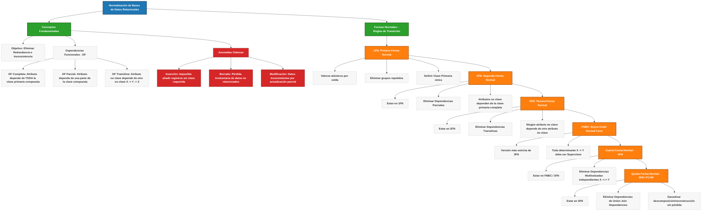

Tarea 4.1: Fundamentos de Normalización | Bases de Datos 

<!-- Start of picture text -->
=n as <!-- End of picture text -->

TECNOLOGICO **Tarea 3.1 |** NACIONAL DE MEXICO 

# **Tarea 4.1: Fundamentos de Dependencias y Mapa Conceptual de Formas Normales** 

**Asignatura:** Sistemas de Bases de Datos **Docente** : Ruben Miguel Riojas Rodríguez **Alumno:** Eduardo Salazar Martínez 

Documento Técnico de Normalización de Bases de Datos Relacionales 

Tarea 4.1: Fundamentos de Normalización | Bases de Datos 

## **1. Introducción al Diseño Relacional y Normalización** 

La normalización de bases de datos relacionales es una disciplina formal introducida originalmente por Edgar F. Codd. Su objetivo primordial es estructurar los esquemas de tablas para eliminar la redundancia de información, evitar anomalías operacionales y asegurar que cada hecho de datos se almacene en un único lugar lógico. Este proceso garantiza la integridad referencial y optimiza el rendimiento general del sistema gestor de bases de datos (SGBD). 

## **2. Concepto Formal de Normalización** 

Formalmente, la normalización es una técnica de análisis relacional que aplica un conjunto de reglas (denominadas **Formas Normales** ) a un esquema de relación. El proceso descompone relaciones complejas o mal diseñadas en relaciones más pequeñas y bien estructuradas sin pérdida de información. Cumple con dos propiedades matemáticas fundamentales: 

- **Descomposición sin pérdida de unión (Lossless Join Decomposition):** Garantiza que al descomponer una tabla R en R1 y R2, la operación de natural join de R1 y R2 recupere exactamente el contenido original de R sin generar tuplas espurias. 

- **Preservación de dependencias (Dependency Preservation):** Asegura que todas las dependencias funcionales definidas sobre R puedan ser verificadas únicamente examinando las subrelaciones individuales, sin necesidad de realizar uniones costosas entre tablas. 

## **3. Clasificación de Dependencias Funcionales (DF)** 

Una dependencia funcional es una restricción entre dos conjuntos de atributos en una relación. Se denota como **X → Y** , lo cual significa que si dos tuplas coinciden en el valor del atributo X (determinante), obligatoriamente deben coincidir en el valor del atributo Y (dependiente). 

### **3.1 Dependencia Funcional Completa** 

Ocurre cuando un atributo no clave depende funcionalmente de la **totalidad** de una clave primaria compuesta, y no de ninguno de sus subconjuntos propios. Formalmente, dada la clave primaria X = {A, B}, la dependencia X → C es completa si ni A → C ni B → C son válidas por sí solas. 

### **3.2 Dependencia Funcional Parcial** 

Se presenta cuando un atributo no clave depende únicamente de un **subconjunto propio** de una clave primaria compuesta. Por ejemplo, en una clave compuesta {ID_Estudiante, ID_Curso}, si el atributo Nombre_Estudiante depende solo de ID_Estudiante, existe una dependencia parcial que viola la Segunda Forma Normal (2FN). 

Documento Técnico de Normalización de Bases de Datos Relacionales 

Tarea 4.1: Fundamentos de Normalización | Bases de Datos 

### **3.3 Dependencia Funcional Transitiva** 

Ocurre cuando un atributo no clave depende de otro atributo que tampoco es clave, formando una cadena de dependencias **X → Y → Z** , donde X es la clave primaria, Y no es superclave y Z es un atributo dependiente no clave. Esta dependencia viola la Tercera Forma Normal (3FN). 

## **4. Anomalías Clásicas en Esquemas No Normalizados** 

El diseño defectuoso de esquemas relacionales introduce anomalías que degradan la consistencia de los datos y complican el desarrollo de aplicaciones: 

### **4.1 Anomalía de Inserción** 

Se produce cuando no es posible registrar cierta información válida en la base de datos sin obligar a ingresar datos no disponibles o inventados en la clave primaria o en atributos requeridos. Ejemplo: No poder registrar un nuevo curso académico hasta que al menos un estudiante se inscriba en él. 

### **4.2 Anomalía de Borrado** 

Ocurre cuando la eliminación de una tupla provoca la pérdida involuntaria e irreversible de otra información esencial. Ejemplo: Al dar de baja al único estudiante inscrito en un curso, se elimina automáticamente toda la existencia del curso en el sistema. 

### **4.3 Anomalía de Modificación (Actualización)** 

Se genera cuando la actualización de un dato duplicado en una fila no se propaga a todas las demás filas donde se repite. Esto ocasiona inconsistencia en la base de datos, donde la misma entidad muestra valores contradictorios (por ejemplo, dos direcciones distintas para el mismo proveedor). 

## **5. Desarrollo Teórico de las Formas Normales con Ejemplos Prácticos** 

### **5.1 Primera Forma Normal (1FN)** 

**Reglas:** Todos los atributos de la tabla deben contener únicamente valores atómicos (indivisibles). Se deben eliminar grupos de valores repetidos y definir una clave primaria única. 

**Ejemplo 1FN:** Tabla Incompleta: Estudiante(ID, Nombre, Teléfonos ['555-1234', '555-5678']) Tabla 1FN: Estudiante_Teléfono(ID_Estudiante, Teléfono) con clave primaria compuesta {ID_Estudiante, Teléfono}. 

Documento Técnico de Normalización de Bases de Datos Relacionales 

Tarea 4.1: Fundamentos de Normalización | Bases de Datos 

### **5.2 Segunda Forma Normal (2FN)** 

**Reglas:** Estar en 1FN y garantizar que todos los atributos no clave dependan funcionalmente de la clave primaria completa, eliminando todas las dependencias parciales. 

**Ejemplo 2FN:** Tabla Incompleta: Inscripción(ID_Alumno, ID_Curso, Nombre_Alumno, Calificación) donde Nombre_Alumno depende solo de ID_Alumno. 

Solución 2FN: Separar en Alumno(ID_Alumno, Nombre_Alumno) e Inscripción(ID_Alumno, ID_Curso, Calificación). 

### **5.3 Tercera Forma Normal (3FN)** 

**Reglas:** Estar en 2FN y eliminar las dependencias transitivas. Ningún atributo no clave debe depender de otro atributo no clave. 

**Ejemplo 3FN:** Tabla Incompleta: Empleado(ID_Emp, Nombre, ID_Depto, Nombre_Depto) donde Nombre_Depto depende de ID_Depto (no clave). 

Solución 3FN: Separar en Departamento(ID_Depto, Nombre_Depto) y Empleado(ID_Emp, Nombre, ID_Depto). 

### **5.4 Forma Normal de Boyce-Codd (FNBC)** 

**Reglas:** Es una extensión más estricta de la 3FN. Requiere que para toda dependencia funcional X → Y no trivial, X debe ser una superclave. 

**Ejemplo FNBC:** Caso de estudio: Asignación(Alumno, Asignatura, Profesor) donde Profesor → Asignatura pero {Alumno, Asignatura} es clave. Como Profesor no es superclave, viola FNBC. Solución: Profesor_Asignatura(Profesor, Asignatura) y Alumno_Profesor(Alumno, Profesor). 

### **5.5 Cuarta Forma Normal (4FN)** 

**Reglas:** Estar en FNBC y eliminar las dependencias multivaluadas (DMV, X →→ Y) independientes, descomponiendo tablas donde un atributo determina múltiples valores independientes de otros atributos. 

Documento Técnico de Normalización de Bases de Datos Relacionales 

Tarea 4.1: Fundamentos de Normalización | Bases de Datos 

**Ejemplo 4FN:** Tabla Incompleta: Profesor(ID_Prof, Libro_Texto, Deporte) donde un profesor usa varios libros y practica varios deportes de forma independiente. 

Solución 4FN: Profesor_Libros(ID_Prof, Libro) y Profesor_Deportes(ID_Prof, Deporte). 

### **5.6 Quinta Forma Normal (5FN / PJ/NF)** 

**Reglas:** Estar en 4FN y eliminar dependencias de unión (Join Dependencies). Asegura que la relación no pueda ser reconstruida a partir de proyecciones más pequeñas a menos que sus claves lo permitan sin generar combinaciones irreales. 

**Ejemplo 5FN:** Solución 5FN: Descomposición en tres relaciones n-arias donde la combinación ProveedorPieza-Proyecto solo se reconstruye correctamente si se imponen restricciones de proyección cruzada triples. 

## **6. Matriz Sintética de Reglas de Transición y Mapa Conceptual en Mermaid** 

La siguiente matriz resume los requisitos de entrada y la condición de eliminación de dependencias para cada etapa de normalización: 

|**Forma Normal**|**Requisito Previo**|**Dependencia / Anomalia Eliminada**|**Criterio de Validación**|
|---|---|---|---|
|**1FN**|Esquema relacional|Valores no atómicos y grupos repetidos|Cada celda contiene un único valor escalar.|
|**2FN**|Estar en 1FN|Dependencias parciales|Todos los atributos dependen de la clave primaria completa.|
|**3FN**|Estar en 2FN|Dependencias transitivas (X → Y → Z)|Atributos no clave dependen únicamente de la clave primaria.|
|**FNBC**|Estar en 3FN|Determinantes no clave (X → Y)|Todo determinante X es necesariamente superclave.|
|**4FN**|Estar en FNBC|Dependencias multivaluadas (X →→ Y)|Elimina combinaciones multivaluadas independientes.|
|**5FN**|Estar en 4FN|Dependencias de unión (Join Dependencies)|Garantiza descomposición/reconstrucción sin pérdida.|

Documento Técnico de Normalización de Bases de Datos Relacionales 

Tarea 4.1: Fundamentos de Normalización | Bases de Datos 

### **6.1 Mapa Conceptual** 

Documento Técnico de Normalización de Bases de Datos Relacionales 

